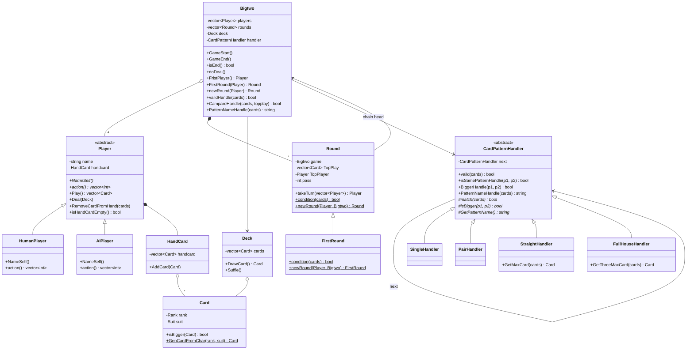
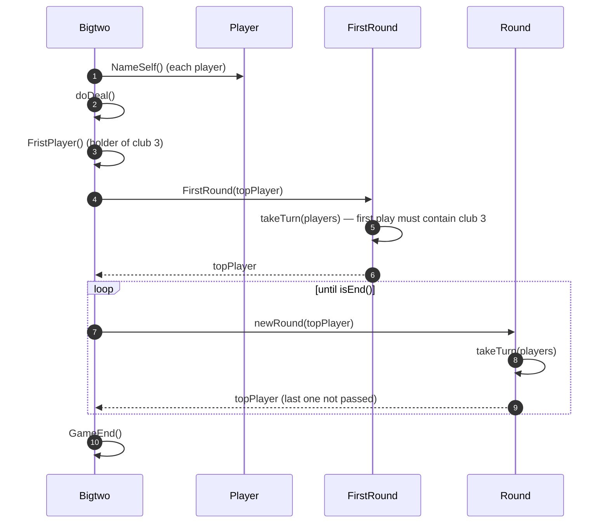
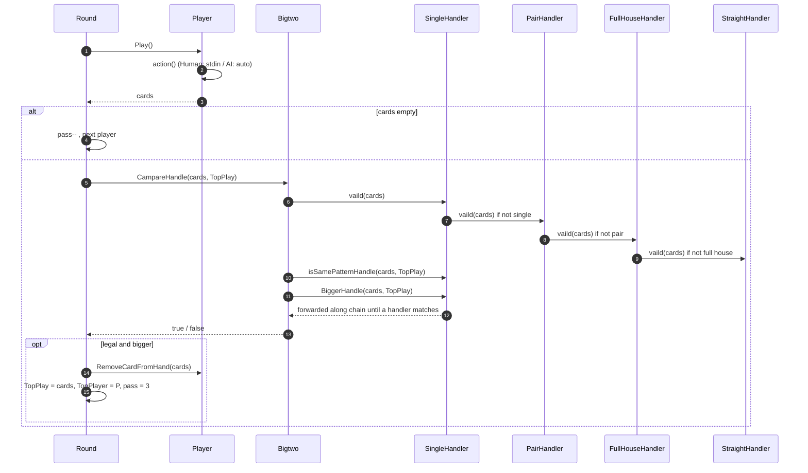

# BigTwo — Diagrams

> **Patterns:** Chain of Responsibility (`CardPatternHandler`) + Template Method / hook (`Round` → `FirstRound`) + Strategy (`Player::action`)

## Class Diagram

## Sequence Diagram — game flow

## Sequence Diagram — validating and comparing a play (CoR)

Chain built in `main()`: `Single → Pair → FullHouse → Straight`

