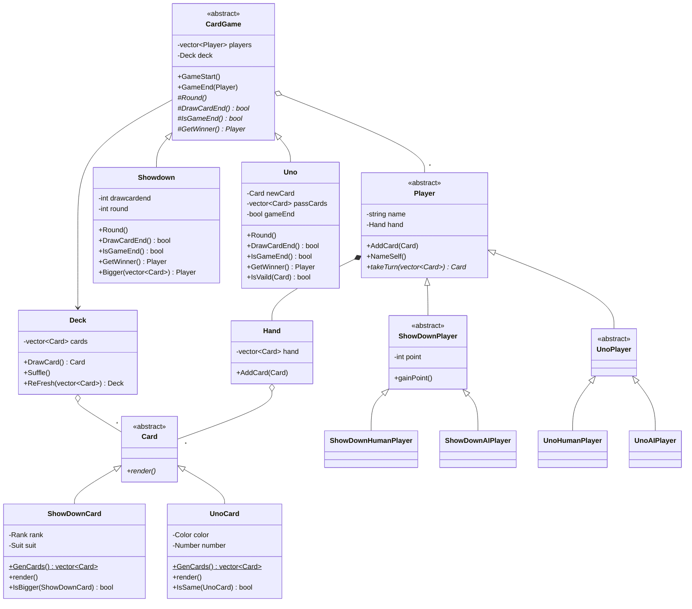
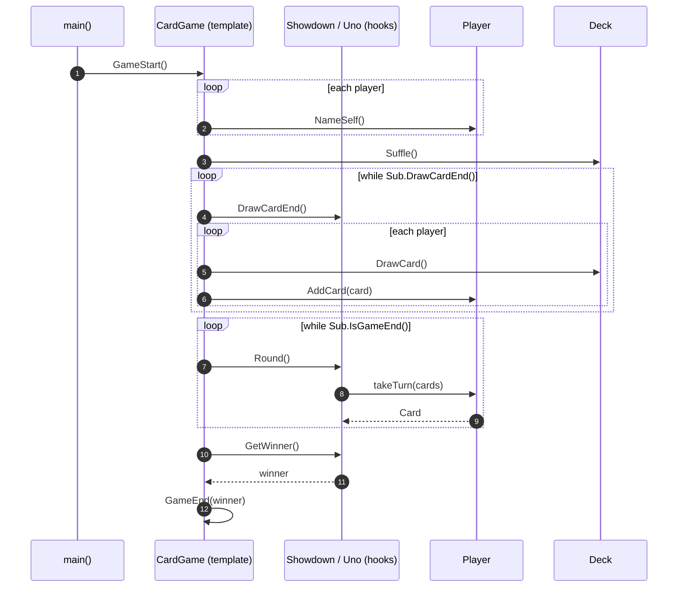

# CardGameFramework — Diagrams

> **Pattern:** Template Method (`CardGame::GameStart`)

## Class Diagram

## Sequence Diagram — the template method

> The order of steps is fixed in `CardGame`. `Showdown` and `Uno` only fill in the hook methods (`Round`, `DrawCardEnd`, `IsGameEnd`, `GetWinner`).
