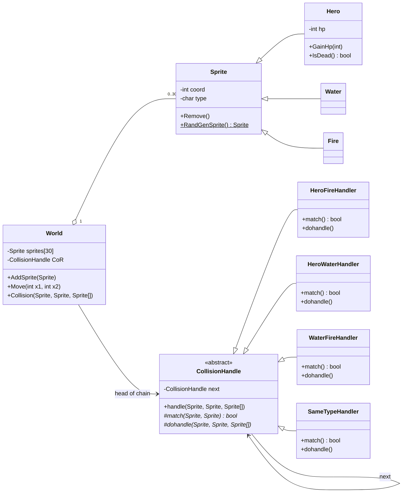
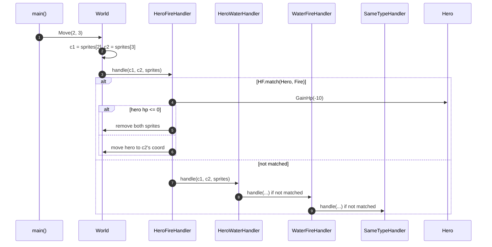

# Collision — Diagrams

> **Pattern:** Chain of Responsibility (`CollisionHandle`)

## Class Diagram

## Sequence Diagram — Hero moves onto Fire

Chain built in `main()`: `HeroFireHandler → HeroWaterHandler → WaterFireHandler → SameTypeHandler`

> Adding a new collision rule = adding one new handler class and linking it into the chain. `World` never changes.
