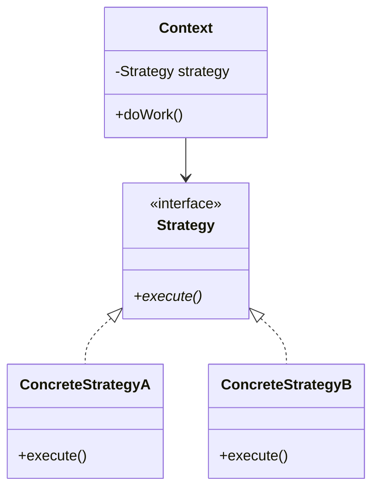
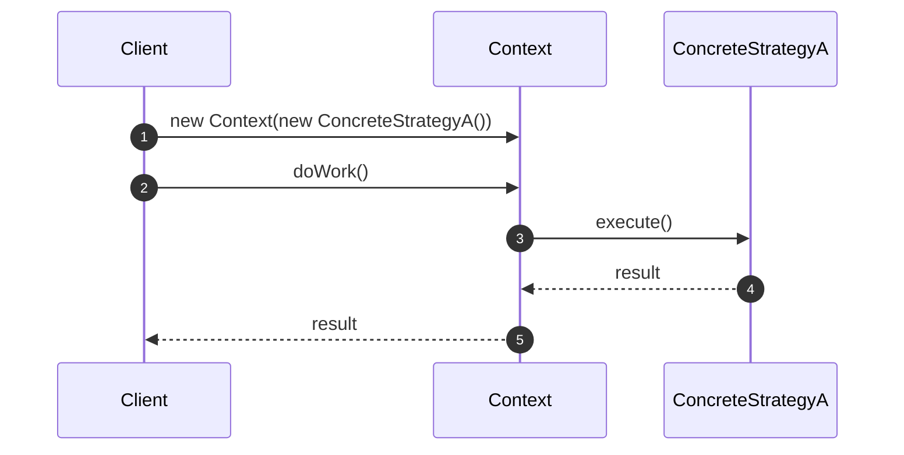

# <ProjectName> — Diagrams

> **Pattern(s):** <e.g. Strategy + Observer>
>
> Copy this file to `<ProjectName>/diagrams.md` when you add a new project folder, then add a row to the **Projects** table in the root `README.md`.

| Role | Class |
|---|---|
| <e.g. Context> | `<ClassName>` |
| <e.g. Strategy> | `<InterfaceName>` |
| <e.g. Concrete strategy> | `<ClassA>`, `<ClassB>` |

## Class Diagram

## Sequence Diagram — <main flow>

<!--
Mermaid cheat sheet
───────────────────
Class members
  +public  -private  #protected
  method()*   abstract (italic)      method()$   static (underlined)
  vector~Card~  generic type (use ~ instead of < >; avoid trailing * on types)
  <<interface>> <<abstract>> <<enumeration>>   annotations

Relationships
  A <|-- B   inheritance            A <|.. B   realization (implements)
  A *-- B    composition            A o-- B    aggregation
  A --> B    association            A ..> B    dependency
  A "1" --> "*" B : label           multiplicity + label

Sequence diagrams
  A->>B: call        A-->>B: return
  loop / alt ... else / opt / par ... end
  Note over A,B: text
  actor U as User    participant X as Alias

Other diagram types you may need
  stateDiagram-v2    (State pattern)
  flowchart LR       (algorithm / control flow)
-->
