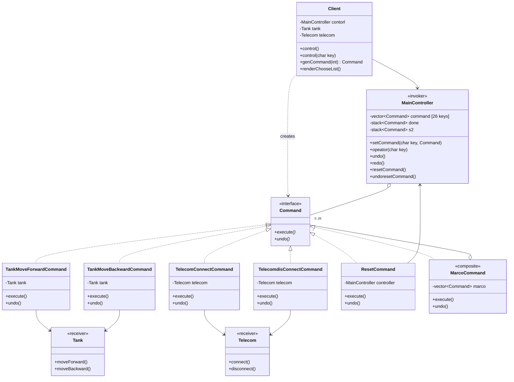
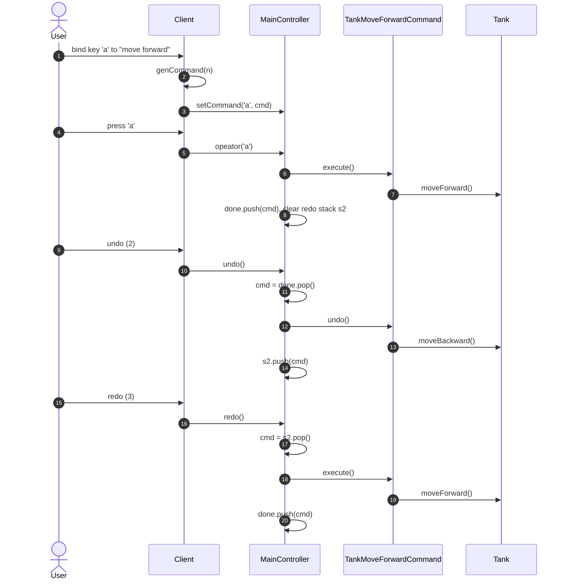
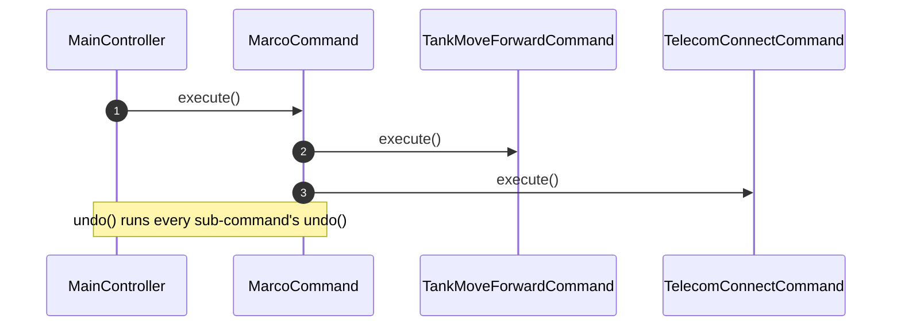

# KeyBoardShortCut — Diagrams

> **Pattern:** Command (with undo / redo and macro commands)

| Role | Class |
|---|---|
| Client | `Client` |
| Invoker | `MainController` |
| Command | `Command` + concrete commands |
| Receiver | `Tank`, `Telecom`, `MainController` (for `ResetCommand`) |

## Class Diagram

## Sequence Diagram — press a key, undo, redo

## Sequence Diagram — macro command

