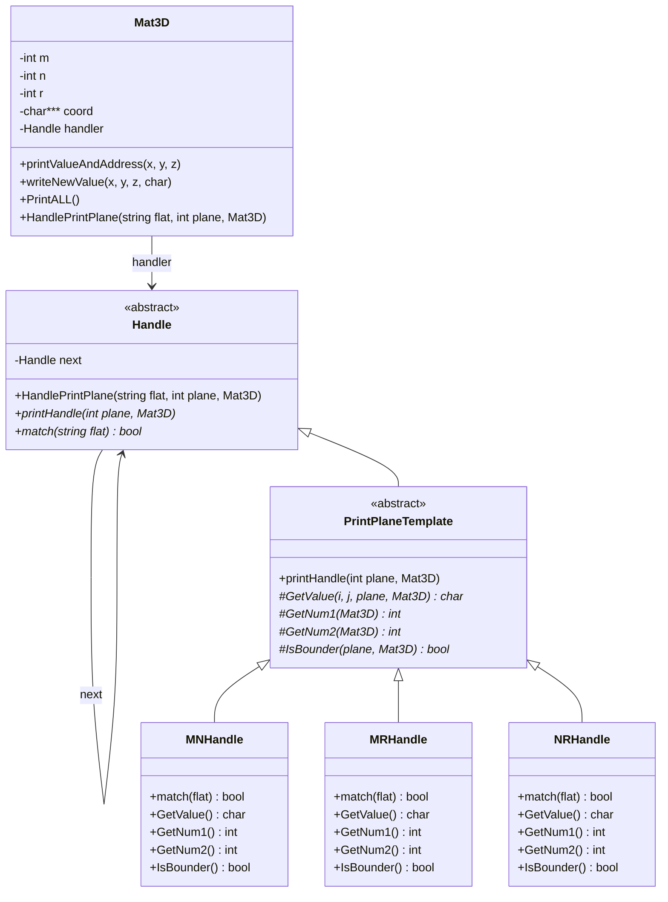
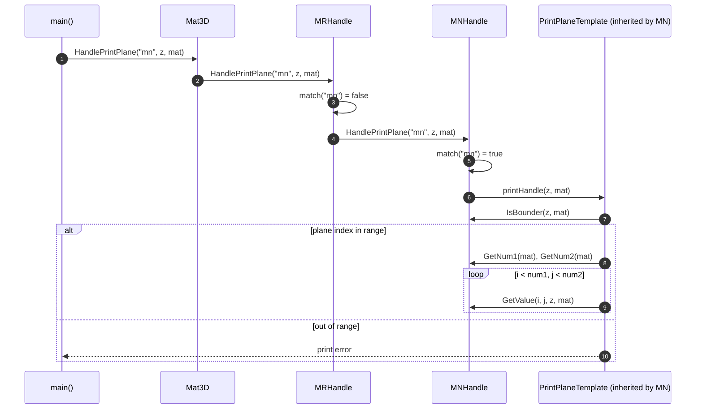

# Mat3D — Diagrams

> **Patterns:** Chain of Responsibility (`Handle`) + Template Method (`PrintPlaneTemplate`)

## Class Diagram

## Sequence Diagram — print the "MN" plane

Chain built in `main()`: `MRHandle → MNHandle → NRHandle`

> **CoR** decides *which* plane handler runs. **Template Method** fixes *how* a plane is printed; subclasses only supply indexing (`GetNum1/GetNum2/GetValue`) and bounds checking.
