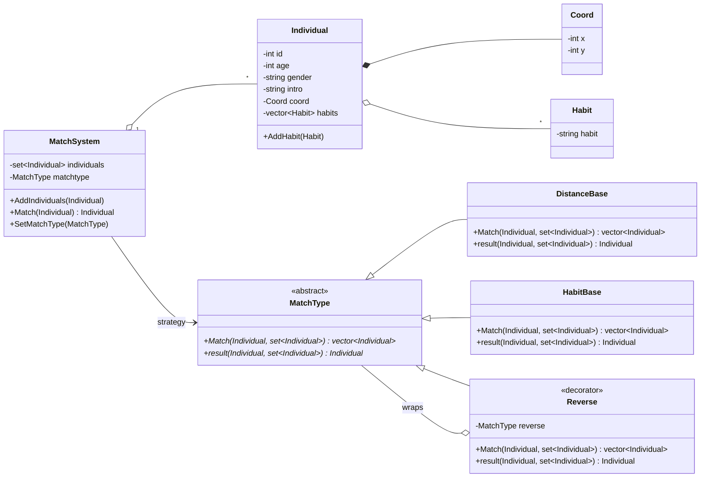
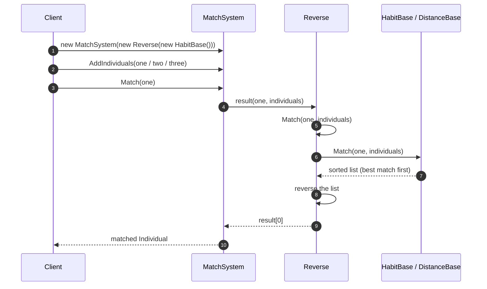

# MatchSystem — Diagrams

> **Patterns:** Strategy (`MatchType`) + Decorator (`Reverse`)

## Class Diagram

## Sequence Diagram — matching with a decorated strategy

> Without the decorator, `MatchSystem` calls `HabitBase::result()` directly and gets the best match. Wrapping it in `Reverse` changes the outcome without touching `HabitBase`.
