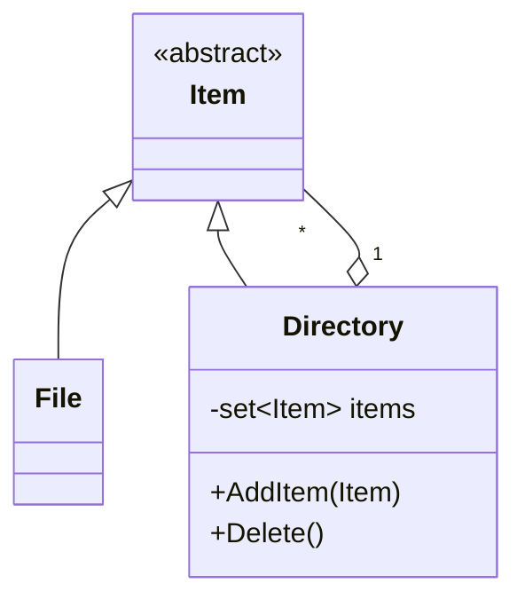
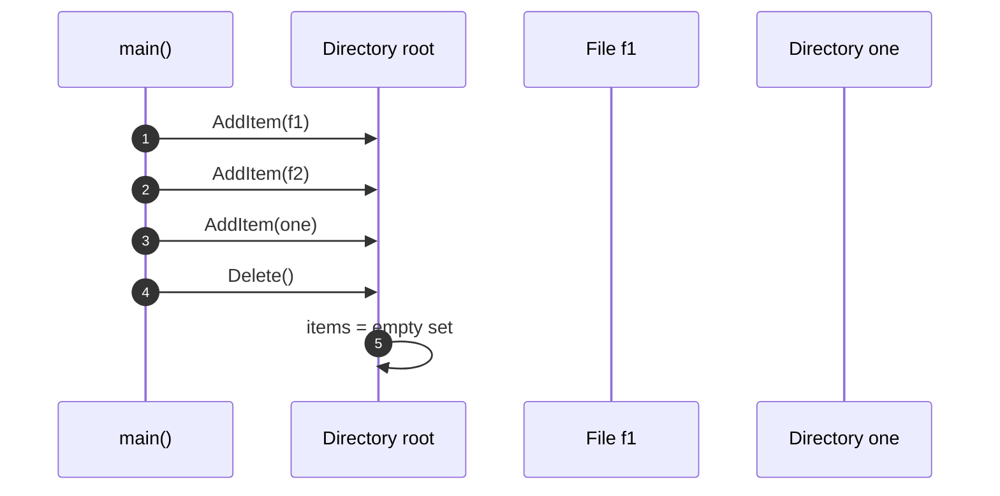

# OOA_Training / 11 — File system

> **Concept:** Recursive structure (Composite shape) — a `Directory` holds `Item`s, which can be `File`s or other `Directory`s.

## Class Diagram

## Sequence Diagram

