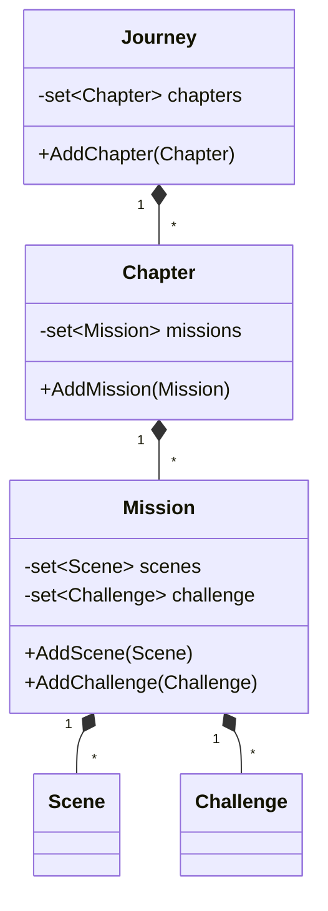
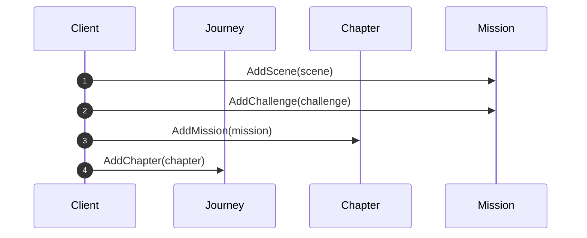

# OOA_Training / 12 — Journey structure

> **Concept:** Multi-level aggregation — Journey → Chapter → Mission → Scene / Challenge. (Model only; `main()` is empty.)

## Class Diagram

## Sequence Diagram

