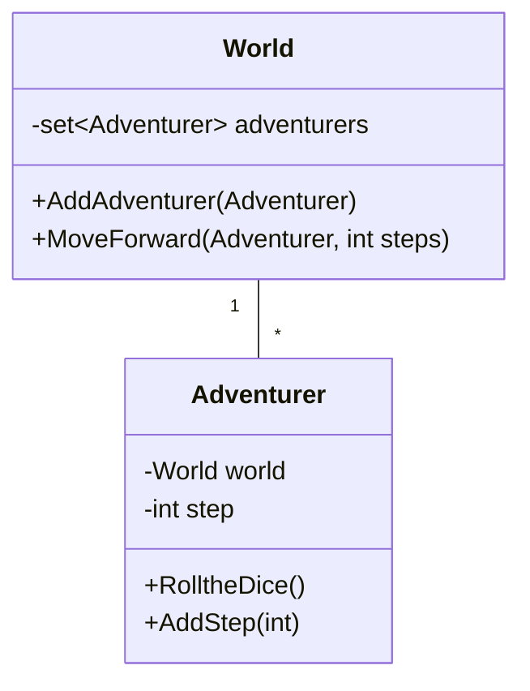
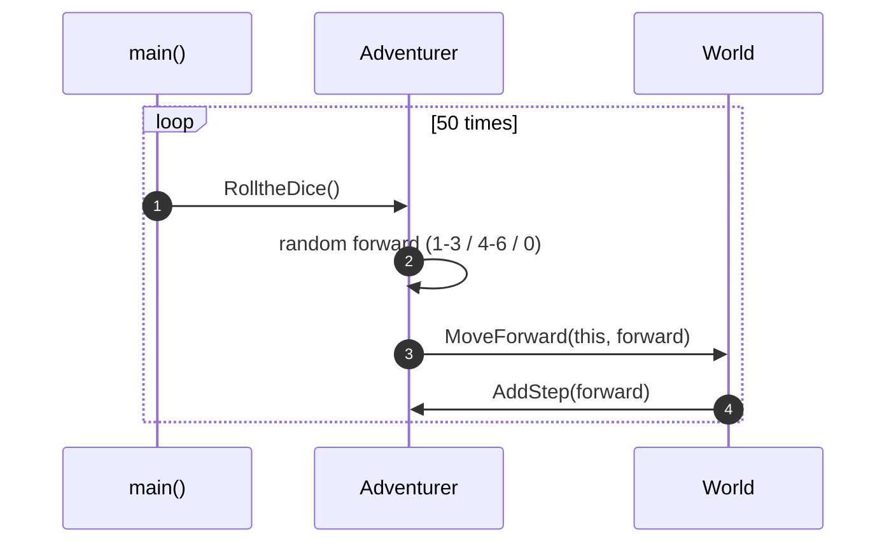

# OOA_Training / 13 — World and Adventurer

> **Concept:** Bidirectional association with behaviour delegation — the adventurer rolls a die and asks the world to move it.

## Class Diagram

## Sequence Diagram

