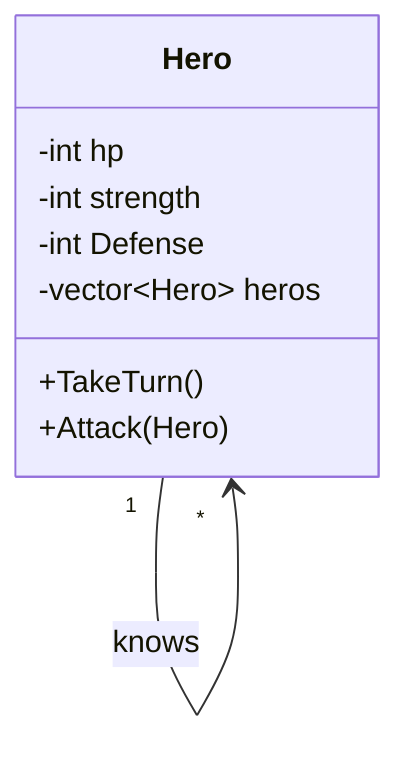
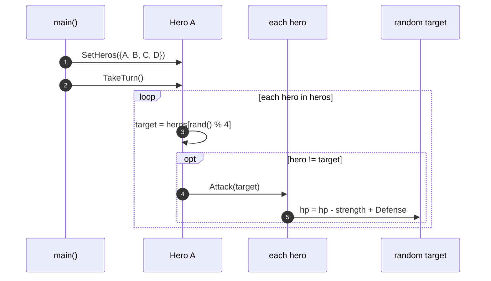

# OOA_Training / 14 — Heroes attack each other

> **Concept:** Self-association used for interaction — each `Hero` knows the other heroes and attacks a random one.

## Class Diagram

## Sequence Diagram

