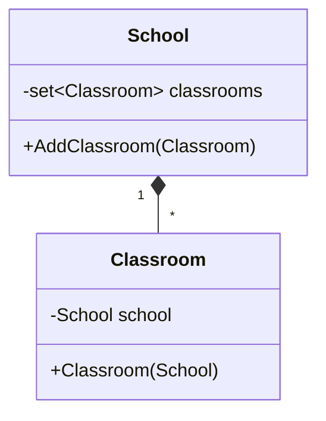
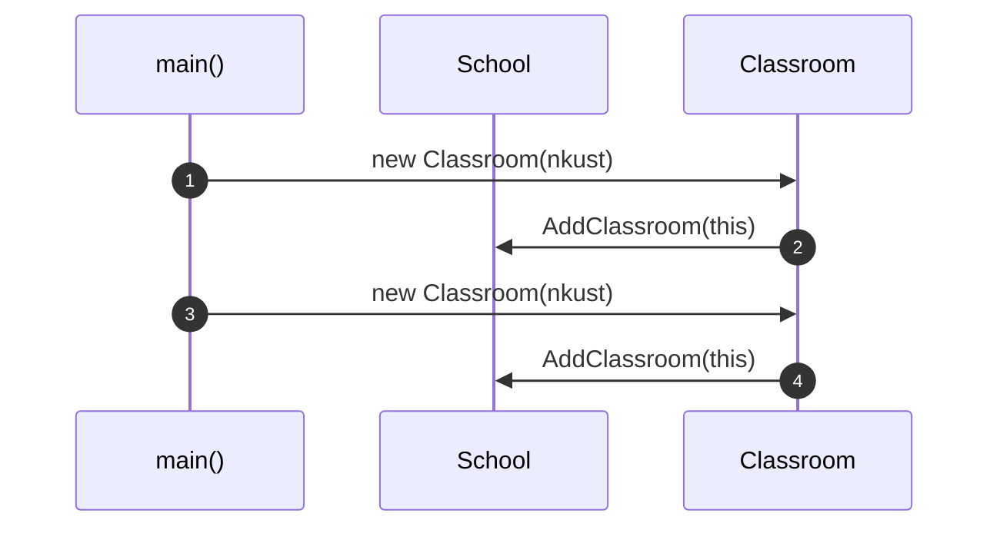

# OOA_Training / 4 — School has Classroom

> **Concept:** Composition-style aggregation — a `Classroom` cannot exist without its `School` (passed in the constructor) and registers itself.

## Class Diagram

## Sequence Diagram

