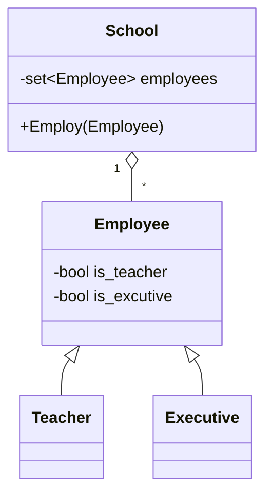
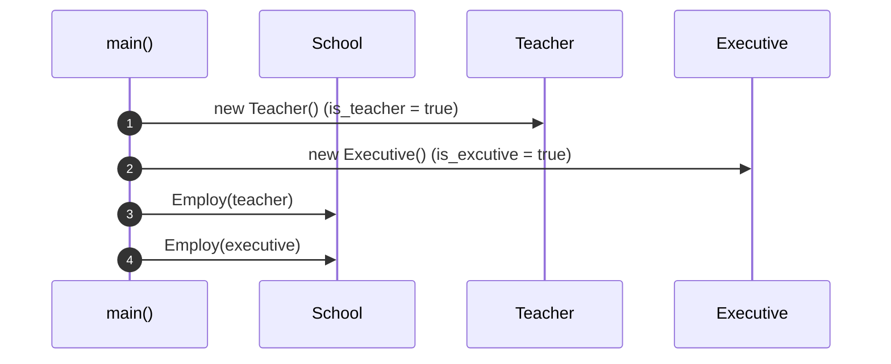

# OOA_Training / 5 — Employee generalization

> **Concept:** Generalization — `Teacher` and `Executive` share the `Employee` base; `School` depends only on `Employee`.

## Class Diagram

## Sequence Diagram

