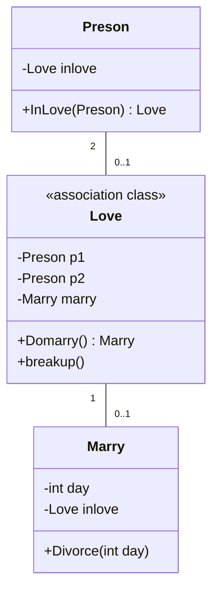
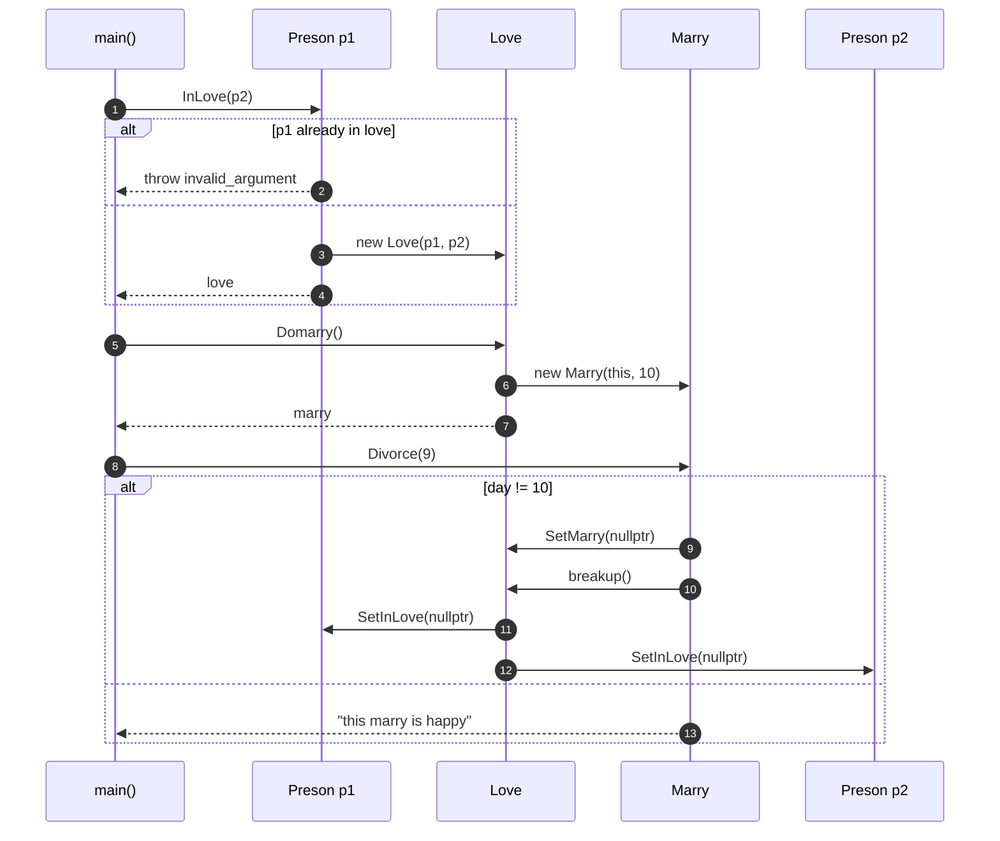

# OOA_Training / 6 — Person, Love, Marry

> **Concept:** Association classes with lifecycle — `Love` links two persons; `Marry` is created from a `Love` and can break it.

## Class Diagram

## Sequence Diagram

