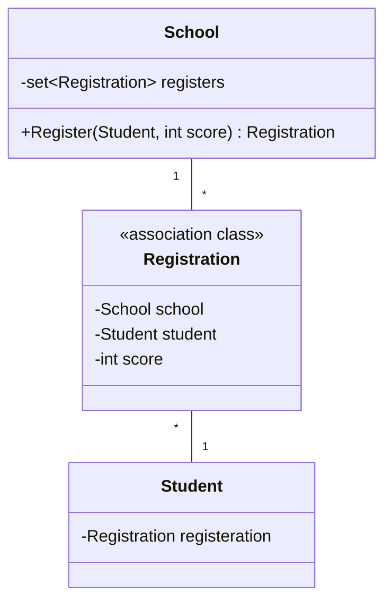
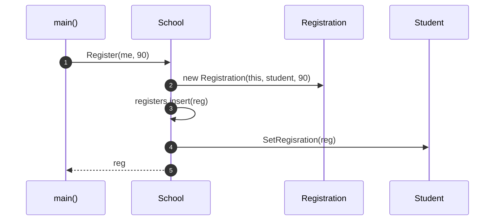

# OOA_Training / 8 — Registration with score

> **Concept:** Association class carrying data — the `score` belongs to the relationship between `School` and `Student`, not to either side.

## Class Diagram

## Sequence Diagram

