# RPGGame — Diagrams

> **Patterns:** Template Method + State（`State` 主導一次行動的流程）、Strategy（`IAction` 決策者、`Skill` 行動）、Observer（`SkillObserver` 死亡事件）、Chain of Responsibility（`OnePunchHandler`，由 Client 注入）
>
> **依據：** [`CLAUDE.md`](CLAUDE.md) §5 設計決策 D1–D39（2026-10-12 架構設計完成）與 §7 實作紀錄。
>
> **2026-10-14 更新**：**全部已實作**（技能周邊、Role、Observer、`IAction` / `AIAction` / `HeroAction`、State 行動流程、`Battle`、`RPG`、Client 的 parser 與 `main.cpp`），圖中**使用程式裡的實際名稱**（例如 `attack`、`addSkill`、`State::decision`），並補上實作時的修正（`lossHp` 只印一次死亡、`setTroop(nullptr)`、`announce`、`handle` 回傳 `bool`）。下表標出各部分的狀態。

| Role | Class | 實作 |
|---|---|---|
| 遊戲 / 關聯類別（兩軍對戰） | `RPG`、`Battle`（D1） | ✅ |
| Client（模組外部） | `RPG_parser`（`test/libary`）、`main.cpp` | ✅ |
| Context（持有狀態與決策者） | `Role` | ✅ |
| State（Template Method 骨架在抽象類別） | `State` ← `NormalState`、`PoisonedState`、`PetrochemicaledState`、`CheerupedState` | ✅ |
| Strategy：決策者 | `IAction` ← `AIAction`、英雄的 `IAction`（暫稱 `HeroAction`） | ✅ |
| Strategy：行動 | `Skill` ← `BasicAttack` + 10 種技能 | ✅ |
| Observer | `SkillObserver` ← `SummonObserver`、`CurserObserver` | ✅ |
| Chain of Responsibility | `OnePunchHandler` ← `HpHandler`、`PoisonPetrochemicalHandler`、`CheerupHandler`、`NormalHandler` | ✅ |

### 與舊版（從程式碼反推的圖）相比的主要改變

| 改變 | 決策 |
|---|---|
| 移除 `Hero` / `AI` 這兩個 `Role` 子類別，改由 `Role` 持有 `IAction`；`seed` 移到 `AIAction` | D4（✅ 2026-10-14 已刪除）；`NonHero` 也刪除，`Slime` 直接繼承 `Role`（D43） |
| 一次行動的流程由 `State` 主導，固定流程寫在 `State` 抽象類別 | D10、D12 |
| 傷害一律經過 `actor.state.doDamage()` → `target.state.damage()` → `target.lossHp()`；`lossHp` 為 private、`damage` 為 protected，技能只能走 `doDamage`（編譯器強制） | D16、D17、D47 |
| 觀察者改為 pull model：`UntilDie(dead)` 帶入死者 | D18 |
| 候選名單改由技能計算（`getCandidates`），移除 `targetEnemy` / `targetFriend` | D29、D33 |
| Battle 交給行動流程的是 T1 / T2 活著的角色名單 + 行動者屬於哪一軍 | D30、D31 |
| 一拳攻擊的處理鏈改為 `vector` 並由 Client 注入；handler 介面加入 `actor`；移除 `next` 指標 | D21–D23 |
| handler 用型別判斷狀態，不再比對字串 | D25 |

### 圖上名稱 ↔ 程式名稱（2026-10-14 對齊）

| 舊圖的暫定名稱 | 程式裡的名稱 | 說明 |
|---|---|---|
| `Skill::doAction(actor, targets)` | `Skill::attack(actor, targets)` | 保留 Anthony 原本的名稱 |
| `Role::addAction` / `actions` | `Role::addSkill` / `skills`、`getSkills()` | 同上 |
| `State::takeTurn(t1, t2, actorSide)` | `State::decision(t1, t2, actorSide)` | 保留原本的 `decision`；`Role::takeTurn` 委派給它 |
| `Troop::size()` / `getRole(i)` | `Troop::getRoles()` | 程式沒有 `size` / `getRole`；`Battle` 每圈重新呼叫 `getRoles()`，達到 D20「每圈重讀人數」 |
| `Battle` 的 `t1` / `t2` | `Battle::heroTroop` / `opponentTroop` | 以陣營命名：`heroTroop` = T1（英雄方，先行動）、`opponentTroop` = T2（D45）；不用 `ally` / `enemy`，避免與詞彙表「友軍 / 敵軍」混淆 |
| （無） | `Battle::isHeroAlive()` | 戰鬥結束後 `RPG` 用來決定印「你獲勝了！」或「你失敗了！」（§7.2 I9） |
| 技能建造函式、RPG parser | `RPG_parser::createSkill(name)`、`RPG_parser::parse(istream)` | Client 端，放在 `test/libary`（D26、D36，§7.2 I10） |
| （無） | `Skill::announce(actor, targets)` | §7.2 I1：S3 的行動訊息 |
| （無） | `Skill::othersOf(actor, t1, t2)` | 自爆用：全場其他角色，T1 → T2 |
| （無） | `OnePunchHandler::handle(actor, target) bool` | 包住 `match` + `doHandle`，成立時回傳 `true` |
| （無） | `Troop(int id)`、`Role::getDisplayName()` | §7.2 I2：輸出前綴「[1]」「[2]」 |

---

## OOD — 類別圖

類別圖拆成 7 張，每張只看一個面向，避免全部擠在一起：

| 圖 | 看什麼 |
|---|---|
| ① 總覽 | 所有核心類別之間的**結構關係與數量**（誰持有誰、幾個） |
| ② Role 與 State | Context ↔ State 的雙向關聯、狀態的繼承、狀態之間的依賴 |
| ③ 技能（Strategy） | 11 個行動的繼承，以及每個技能**依賴哪些類別**（建立哪個狀態、哪個觀察者） |
| ④ 一拳攻擊（Chain of Responsibility） | handler 的繼承，以及每個 handler 判斷 / 建立哪些狀態 |
| ⑤ 觀察者（Observer） | 誰被觀察、誰是觀察者、誰負責掛上觀察者 |
| ⑥ 依賴方向：模組 vs 外部擴充 | 驗證需求 ②：刪除外部擴充的檔案，模組不受影響 |
| ⑦ 決策者（Strategy） | `IAction` 介面、`AIAction` 的 seed 規則、與 `Role` 的關係 |

### 圖例

| 符號 | 意思 | 本專案的例子 |
|---|---|---|
| `A <\|-- B`（實線、空心三角） | 繼承：B 是 A | `Skill <\|-- Fireball` |
| `A <\|.. B`（虛線、空心三角） | 實作介面 | `IAction <\|.. AIAction` |
| `A *-- B`（實心菱形） | 組合：A 擁有 B，A 解構時 `delete` B | `Role *-- State`、`Role *-- Skill` |
| `A o-- B`（空心菱形） | 聚合：A 持有 B，但不負責釋放 | `Troop o-- Role`、`Role o-- SkillObserver` |
| `A --> B`（實線箭頭） | 關聯：A 的成員變數指向 B | `State --> Role`、`Role --> Troop` |
| `A ..> B`（虛線箭頭） | 依賴：A 只在函式裡**用到** B（參數、`new`、`dynamic_cast`、呼叫），不存成成員 | `Poison ..> PoisonedState : new` |
| `"1"`、`"0..1"`、`"*"`、`"2"` | 數量（多重性）：每一個 A 對應幾個 B | `Troop "1" o-- "*" Role` |

> 組合 / 聚合是依**程式目前誰 `delete` 誰**來畫的：`Role::~Role()` 會 `delete state` 和所有技能，不會 `delete` 觀察者；`Troop`、`OnePunch` 都不 `delete` 它們持有的物件（O1 物件擁有權為開放問題）。

### ① 總覽：結構關係與數量

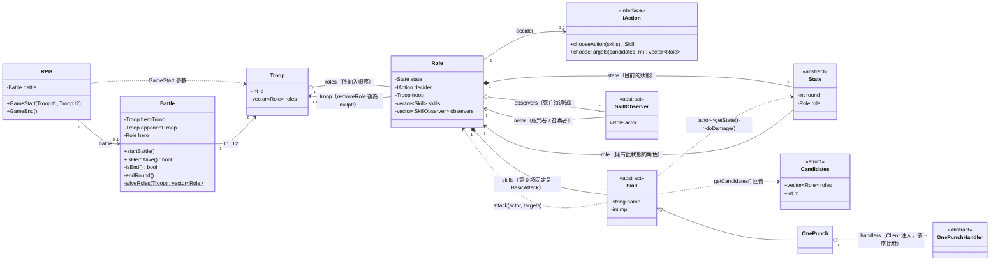

讀圖重點：

- **一個 `Role` 一定有 1 個 `State`**（建立時是 `NormalState`），換狀態時 `setState` 會 `delete` 舊的，所以是組合。`State` 反過來也指向它的 `Role`（雙向），`doDamage` / `damage` 才找得到「行動者」與「受傷者」。
- **一個 `Role` 至少有 1 個 `Skill`**（`BasicAttack`，D28），Client 再加入 0 個以上。
- `Role → Troop` 是 `0..1`：剛建立、或被 `removeRole` 之後都沒有軍隊；這正是 2026-10-14 修正的情境。
- `Role → IAction` 程式目前是 `0..1`（建構時 `decider = nullptr`），設計上 Client 組裝後每個角色都要有 1 個（D4）。
- `Battle → Troop` 是 2（T1、T2）：Battle 是兩軍之間的關聯類別（D1）。

### ② Role 與 State（State pattern）

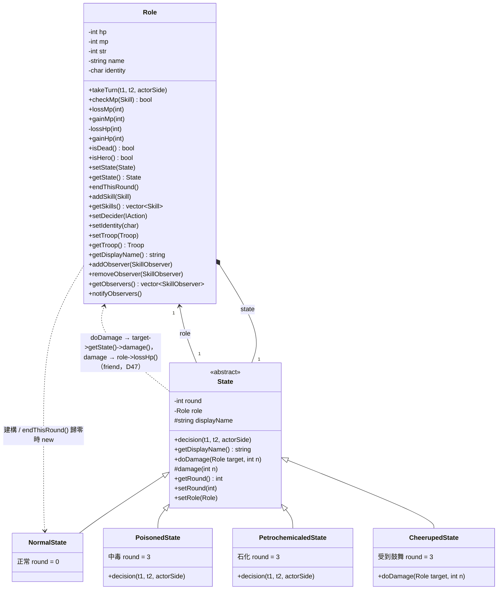

- `Role` 只依賴抽象的 `State` 和**預設狀態** `NormalState`（建構與到期時換回）。石化、中毒、鼓舞由技能建立，`Role` 完全不 include 它們——這是需求 ③（狀態擴充遵守 OCP）在依賴上的樣子。
- `round` 欄位寫在各子類別裡，表示建構時設定的初始值（D11）。
- **`State::decision()` 是預設的行動流程**（D10、D12，✅ 2026-10-14）：S1 印「選擇行動」並問決策者，MP 不足就印「你缺乏 MP…」再問一次 → S2 技能算候選、決策者選目標 → S3 扣 MP、`announce`、`attack`。
- 只有兩個狀態覆寫 `decision()`：`PetrochemicaledState` 整段跳過（不問決策者）；`PoisonedState` 先呼叫自己的 `damage(30)`，死了就結束，活著才呼叫 `State::decision()`。`NormalState`、`CheerupedState` 直接沿用預設流程（`CheerupedState` 只覆寫 `doDamage`）。
- **傷害通道由編譯器強制**（D47）：`Role::lossHp` 是 private，只開放給 `State`（`friend class State`）；`State::damage` 是 protected。技能唯一能用的是 public 的 `doDamage`；自爆的自殺改成技能的 HP 代價 `costHp()`，由 `State::decision()` 在施放後支付。
- 每個狀態自己設定中文名稱 `displayName`（正常 / 石化 / 中毒 / 受到鼓舞），「輪到 …」那一行用 `getDisplayName()` 印，新增狀態不必改 `State`（§7.2 I8）。

### ③ 技能（Strategy）與各自的依賴

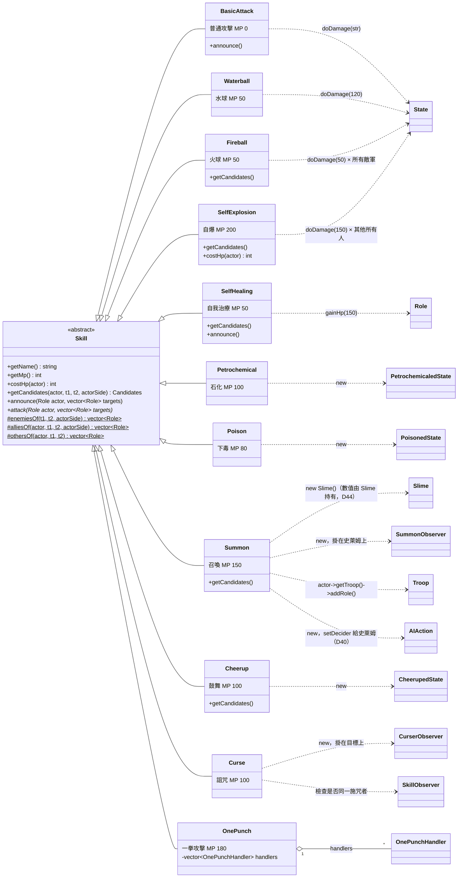

各技能的目標規則（`getCandidates`，D29–D34）：

| 技能 | 候選 | m | 覆寫 `getCandidates`？ |
|---|---|---|---|
| 普通攻擊、水球、石化、下毒、詛咒、一拳攻擊 | 敵軍 | 1 | 否（預設） |
| 火球 | 敵軍 | 全部 | 是 |
| 自我治療、召喚 | 無 | 0 | 是 |
| 鼓舞 | 友軍（不含自己） | 3 | 是 |
| 自爆 | 全場其他角色（T1 → T2） | 全部 | 是 |

### ④ 一拳攻擊（Chain of Responsibility）

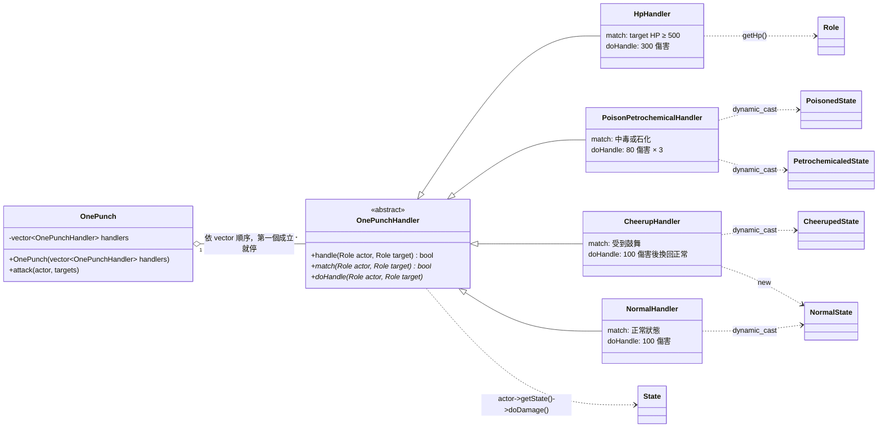

- `OnePunch` 只依賴抽象的 `OnePunchHandler`；具體 handler 依賴哪些狀態都畫在右邊，這些依賴屬於外部擴充（D24、D25）。
- Client 注入的順序：`HpHandler → PoisonPetrochemicalHandler → CheerupHandler → NormalHandler`（需求一拳攻擊的由上而下，D21）。

### ⑤ 觀察者（Observer）

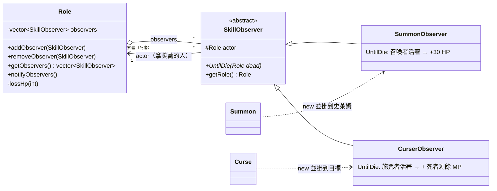

- 同一個 `Role` 在圖上出現兩種角色：**被觀察者**（`observers` 清單的擁有者，死亡時通知）與**觀察者的 `actor`**（施咒者 / 召喚者，拿獎勵）。
- 一個角色可被多位不同施咒者詛咒（`*`），同一施咒者不疊加由 `Curse` 判斷（D19）。

### ⑥ 依賴方向：模組 vs 外部擴充

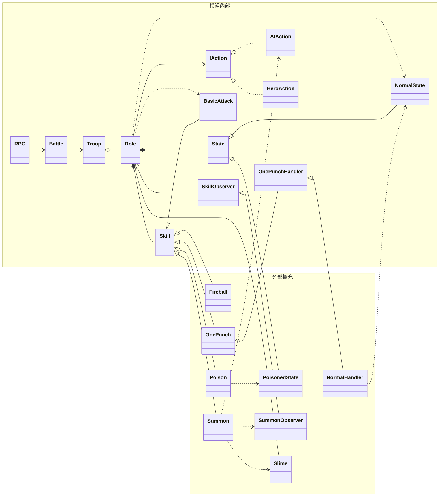

> 圖中外部擴充只挑代表（其他技能、狀態、handler 同理）。檢查方式：**所有箭頭都是「外部 → 模組」或「外部 → 外部」，沒有「模組 → 外部」**，所以刪掉外部擴充的檔案，模組仍能編譯（需求 ②③④）。`AIAction`、`HeroAction`、抽象的 `OnePunchHandler` 屬於模組內部（D41）：新的 AI 或一拳規則在外部實作 `IAction` / `OnePunchHandler` 即可，`Summon ..> AIAction` 也是「外部 → 模組」；`Slime` 直接繼承 `Role`（D43）。

### ⑦ 決策者（Strategy，✅ 2026-10-14）

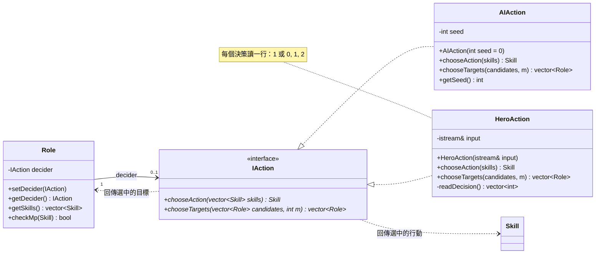

`AIAction` 的 seed 規則（需求「AI 決策」章節）：

| 呼叫 | 回傳 | seed |
|---|---|---|
| `chooseAction(skills)` | `skills[seed % skills.size()]` | + 1（MP 不足由呼叫端再呼叫一次，所以重選也會 + 1） |
| `chooseTargets(candidates, m)`，n > m | `u[s % n], u[(s + 1) % n], …, u[(s + m − 1) % n]` | 全部選完才 + 1（只加一次） |
| `chooseTargets(candidates, m)`，m = 0 或 n ≤ m | 全部候選（略過 S2） | **不變**：不是 AI 做的決策（D8；已用 `waterball-and-fireball-1v2` 中 Slime1 的行動順序驗證） |

- 「MP 是否足夠」不在 `IAction` 裡判斷：`IAction` 只回傳選擇，檢查與印「你缺乏 MP…」由 State 流程呼叫 `Role::checkMp()` 處理（D5、D9），所以新增 `IAction` 實作不會漏掉 MP 檢查。
- 「n ≤ m 自動全選」由每個 `IAction` 實作自己判斷（D8 的取捨）：`AIAction` 不消耗 seed、`HeroAction` 不讀輸入行。
- `HeroAction`：S1 讀一行選行動（MP 不足時再讀下一行）；S2 在 n > m 時讀一行 m 個數字，依輸入順序回傳（D37）。

**圖中的符號說明**

- `Candidates`：`struct { vector<Role*> roles; int m; }`，候選名單與要選的人數（D29）。
- `t1, t2`：Battle 整理好的 T1、T2 名單，**都已排除死者**、各自依隊伍順序；`actorSide`：`int`，1 = T1、2 = T2（D30、D31，§7.2 I3）。
- `identity`：識別字元，`'h'` 代表英雄，其他角色為 `' '`（D6）。
- `getDisplayName()`：有軍隊時回傳「[編號]名稱」，沒有時只回傳名稱。
- `enemiesOf` / `alliesOf` / `othersOf` 後面的 `$` 代表 static（D32）。
- 每個技能子類別各自持有自己的**中文名稱**，輸出時用 `getName()`（D27）。
- `Hero` / `AI` 子類別已刪除（D4），`NonHero` 也已刪除（D43）；召喚用的 `Slime` 直接繼承 `Role`，只畫在 ③ 與 ⑥。

### 每個類別負責什麼

| 類別 | 責任 | 決策 |
|---|---|---|
| `RPG` | `GameStart(t1, t2)` 建立並啟動 `Battle`，結束後依 `isHeroAlive()` 印「你獲勝了！」/「你失敗了！」；`GameEnd()` 釋放 `Battle` | D1、§7.2 I9 |
| `Battle` | 開始時找出 identity 為 `'h'` 的英雄（找不到丟例外）；依 T1 → T2、用索引 + 每圈重讀人數輪流（召喚的史萊姆本回合就能行動）、跳過死者；交給 `takeTurn` 的是兩軍**活著的**名單；**每次行動後**判斷是否結束（英雄死亡 / 一方殲滅）；每回合結束對所有角色 `endThisRound()` | D1、D6、D11、D20、D30、D31 |
| `RPG_parser`（Client） | `parse(istream)`：讀兩軍、T1 第一位設為英雄、其他角色裝 `AIAction`，讀到 `#軍隊-2-結束` 就停（剩下的輸入給 `HeroAction`）；`createSkill(name)`：中文名稱 → 技能、一拳注入需求順序的鏈 | D6、D21、D26、D36、D37、§7.2 I10 |
| `Troop` | 管理角色名單與軍隊編號；`addRole` / `removeRole` 同時設定 / 清除角色的 `troop` | §7.2 I2、§7.3 |
| `Role` | 持有 State、決策者、技能、觀察者；`takeTurn` 委派給 `state->decision()`；`checkMp` 只檢查、不扣、不印；`lossHp` 是 HP 減少的唯一出口（只在「活 → 死」那一刻印死亡、通知觀察者一次）；`setState` 釋放舊狀態並把新狀態綁回自己；回合數歸零時由 Role 換回 `NormalState` | D5、D9、D10、D11、D17 |
| `State` | `decision()` 預設流程（S1 → MP 檢查 → 算候選 → S2 → 扣 MP → `announce` → `attack`）；`doDamage` 套用行動者的加成並印傷害訊息；`damage` 轉交 `lossHp` | D10、D12、D16 |
| `IAction` | 只做兩個決策：選行動、選目標；n ≤ m 時自動全選也由它判斷；`AIAction` 自動全選時 seed 不變 | D4、D5、D7、D8 |
| `Skill` | 宣告 MP、名稱；計算候選；`announce` 印 S3 的行動訊息；`attack` 內每造成一次傷害就呼叫一次 `actor->getState()->doDamage()` | D3、D16、D29、§7.2 I1 |
| `SkillObserver` | 收到死者後自行讀資料、自行判斷施咒者 / 召喚者是否還活著 | D18 |
| `Curse` | 從目標的 observer 清單判斷「同一施咒者不疊加」 | D19 |
| `OnePunch` | 對每位目標依序呼叫 Client 注入的 handler 的 `handle()`，第一個回傳 `true` 就停；**沒有預設鏈** | D21–D23 |

### 模組內部 vs 外部擴充（只列已決定的）

| 範圍 | 包含 | 決策 |
|---|---|---|
| **模組內部** | `RPG`、`Battle`、`Troop`、`Role`、`State`、`NormalState`、`IAction`、`AIAction`、`HeroAction`、`Skill`、`BasicAttack`、`SkillObserver`、`OnePunchHandler`（抽象類別） | D1、D11、D28、D32、D41 |
| **外部擴充**（可直接刪檔，不影響模組） | 10 種技能（含 `OnePunch`）、具體的一拳 handler（`HpHandler` 等）、新增的 AI（實作 `IAction`）；`Curse` / `CurserObserver` 等技能專屬的觀察者；技能帶出的狀態（中毒、石化、鼓舞） | D19、D23、D24、需求 ② |
| **Client** | `main.cpp`、`test/libary/RPG_parser`：讀測資 / 輸入、名稱 → 技能的建造函式、組裝一拳攻擊的處理鏈、建立角色與軍隊、決定每個角色的 `IAction` | D21、D26、D36、D37 |

---

## OOD — 循序圖：Client 組裝與啟動（✅ `main.cpp` + `RPG_parser`）

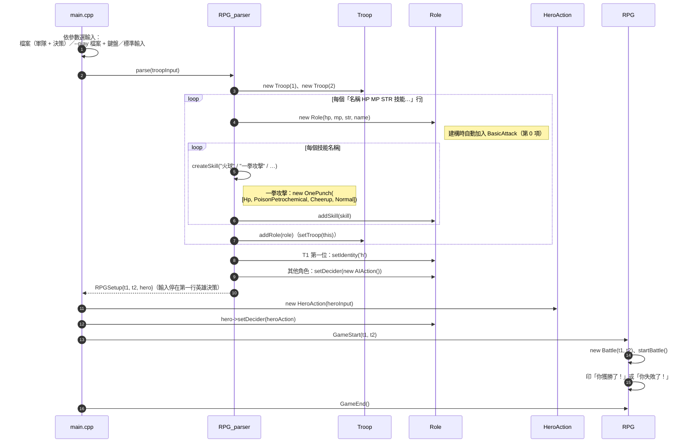

> `heroInput`（D37）：讀測資時是**同一個檔案串流**（parser 讀完軍隊後剩下的就是決策行）；`--play` 時是 `std::cin`；不帶參數時軍隊與決策都來自 `std::cin`。S1 和 S2 共用同一串輸入。

## OOD — 循序圖：角色加入 / 離開軍隊（✅ 2026-10-14 修正）

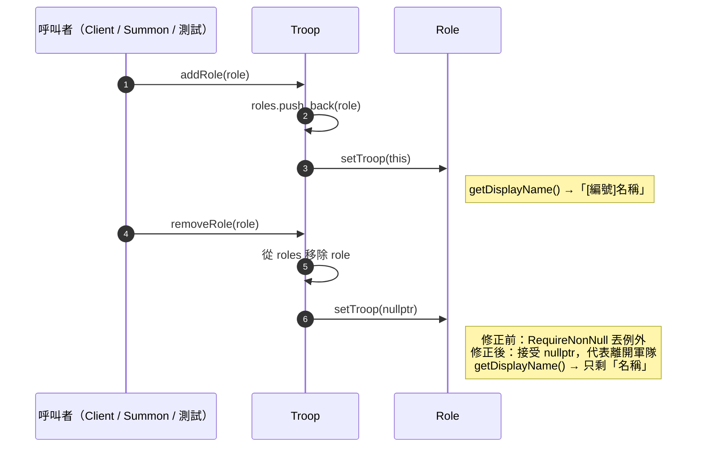

> 召喚（`Summon::attack`）用 `actor->getTroop()->addRole(slime)` 把史萊姆加到施放者所屬軍隊的隊尾，所以史萊姆自動帶對的前綴（D20、§7.2 I2）。目前程式沒有地方呼叫 `removeRole`；死者仍留在名單中，由 Battle 跳過。

## OOD — 循序圖：一回合與一次行動（✅）

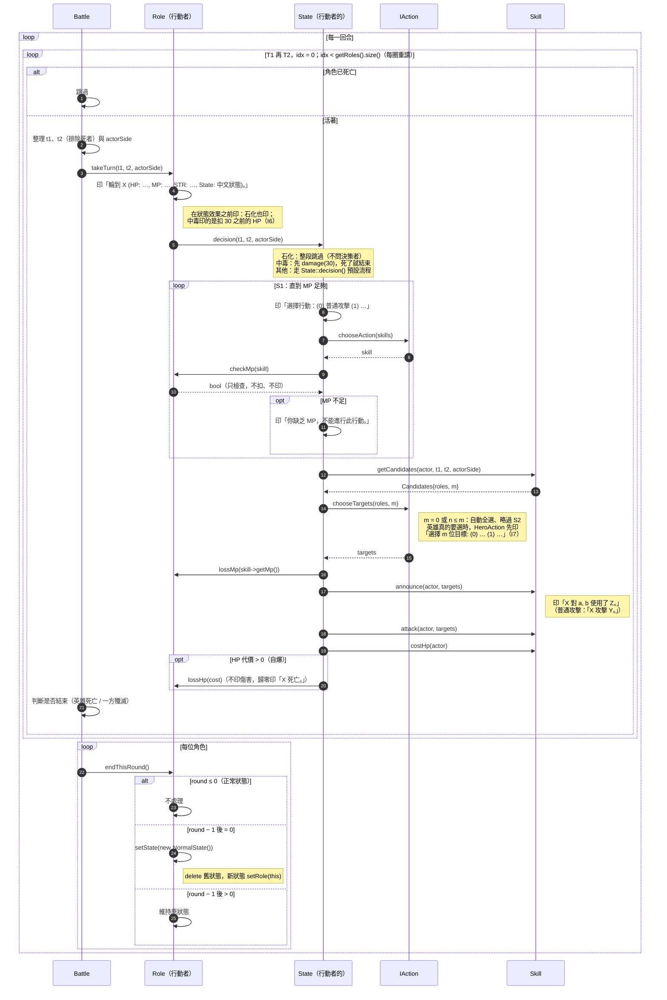

> 整張圖都已實作（✅）：`Battle::startBattle()` 的回合迴圈、`Role::takeTurn` 之後的整段流程、`endThisRound`。已用 `testcases/` 10 組整場比對驗證（見 [`test/TESTS.md`](test/TESTS.md) RP）。

## OOD — 循序圖：傷害、死亡與觀察者（✅）

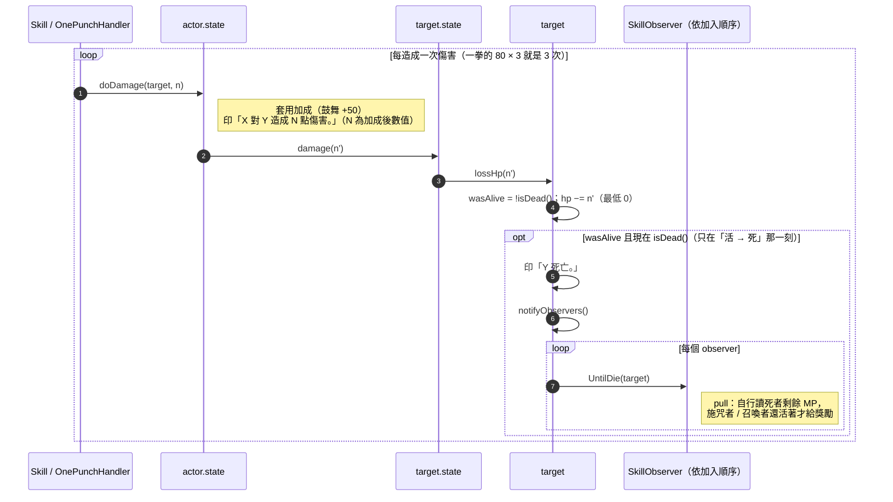

> 中毒扣的 30 HP（`State::damage`）、自爆的 HP 代價（`State::decision()` 支付）也都經過 `lossHp()`，所以同樣會印死亡、觸發觀察者（D14、D17、D47）。
> 已經死亡的角色再受到傷害不會重複印死亡、不會再通知觀察者。一拳攻擊的 80 × 3 在目標死亡後就停止，不再印剩下幾下的傷害（§7.2 I4，依 `testcases/one-punch.out` 修正）。
> 獎勵（`gainHp`）發生在「Y 死亡。」之後；`SummonObserver` +30、`CurserObserver` + 死者剩餘 MP。
> 自爆：目標不含自己、依 T1 → T2；對所有目標處理完後，由 `State::decision()` 支付 HP 代價 `costHp()` = 全部 HP，讓自己歸零並印「<自己> 死亡。」（D47），自己歸零**不印**傷害訊息（D34，已用 `testcases/self-explosion.out` 驗證）。

## OOD — 循序圖：一拳攻擊（Chain of Responsibility，✅）

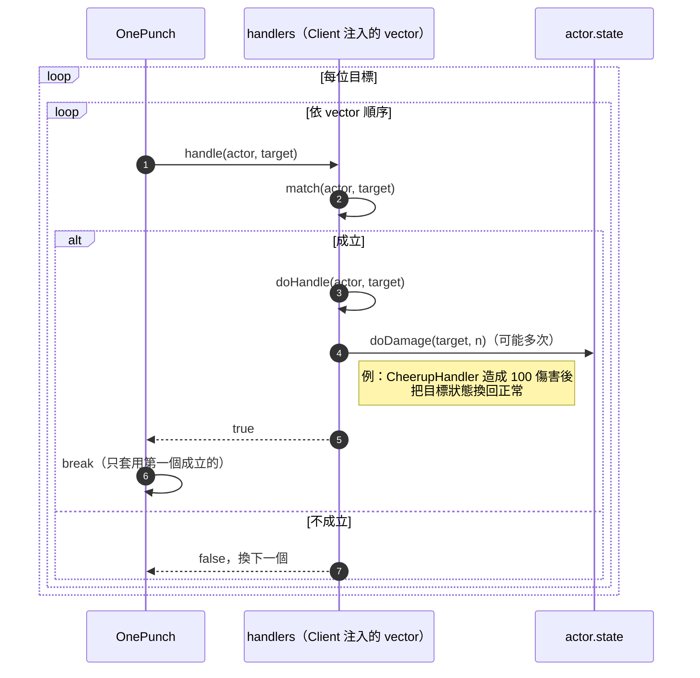

> handler 用型別判斷（`dynamic_cast`）辨認目標的狀態，不比對字串（D25）；具體 handler 和它們依賴的狀態一起屬於外部擴充（D24）。

## State Diagram — role states（狀態機）

角色身上的狀態效果（State pattern 的 4 個具體狀態）之間**所有的轉移**。

- 菱形是「被施加狀態」的分岔：**任何狀態**（包括已經是同一種狀態）被施加新狀態時，都會覆寫成新狀態並重設 round = 3。
- 石化 / 中毒 / 受到鼓舞在每回合結束時由 `endThisRound()` 把 round − 1，round > 0 時維持原狀態；歸零時由 **Role** 換回正常。
- 任何狀態下 HP ≤ 0 都會死亡（見轉移表最後一列），圖中省略以免線太多。

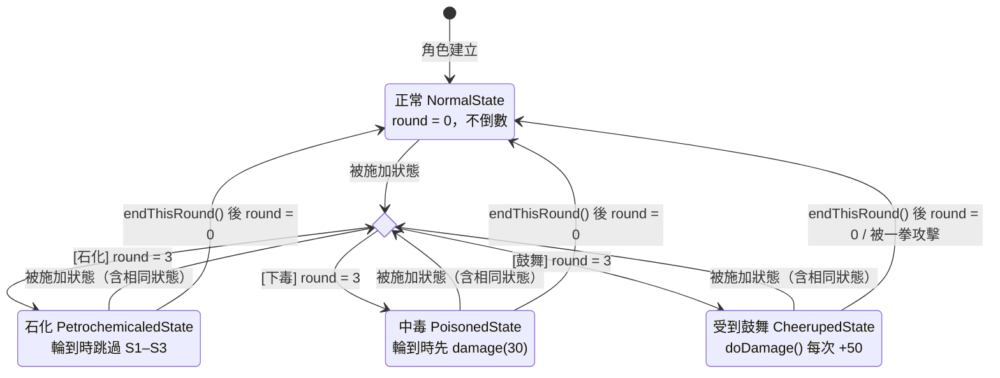

### 轉移表

| 目前狀態 | 事件 | 條件 | 轉移後 | 動作 / 由誰執行 | 依據 |
|---|---|---|---|---|---|
| 任一狀態（含相同狀態） | 被「石化」命中 | — | 石化 | `target->setState(new PetrochemicaledState())`，round = 3；`setState` 釋放舊狀態並把新狀態綁回角色 | 需求「覆寫並重新倒數」、D11 |
| 任一狀態（含相同狀態） | 被「下毒」命中 | — | 中毒 | 同上，round = 3 | 同上 |
| 任一狀態（含相同狀態） | 被「鼓舞」選為目標 | — | 受到鼓舞 | 同上，round = 3 | 同上 |
| 正常 | 回合結束 `endThisRound()` | round ≤ 0 | 不變 | 直接返回，不倒數 | D11 |
| 石化 / 中毒 / 受到鼓舞 | 回合結束 `endThisRound()`（Battle 呼叫） | round > 1 | 不變 | Role 將 round − 1 | D11 |
| 石化 / 中毒 / 受到鼓舞 | 回合結束 `endThisRound()` | round = 1（−1 後歸零） | 正常 | **Role** 呼叫 `setState(new NormalState())`（不由 State 自己換） | D11 |
| 受到鼓舞 | 被一拳攻擊命中 | 不符合「HP ≥ 500」「中毒或石化」 | 正常 | `CheerupHandler` 先造成 100 傷害，再 `setState(new NormalState())` | 需求一拳第 3 條、D24 |
| 任一狀態 | `lossHp()` 後由活轉死 | — | （角色死亡） | 印「X 死亡。」、通知觀察者（各一次）；之後 Battle 跳過此角色 | D17、D20 |

**round 的計算**（D11）：施加當下的回合算第 1 回合。例：第 1 回合被石化 → round = 3；第 1、2、3 回合結束時各 −1，第 3 回合結束歸零 → 第 4 回合恢復正常，所以第 1、2、3 回合都被跳過。正常狀態 round = 0，不倒數。被覆寫時新狀態重新從 3 開始。

## 測試：整場輸入 → 輸出比對（D35–D39，✅）

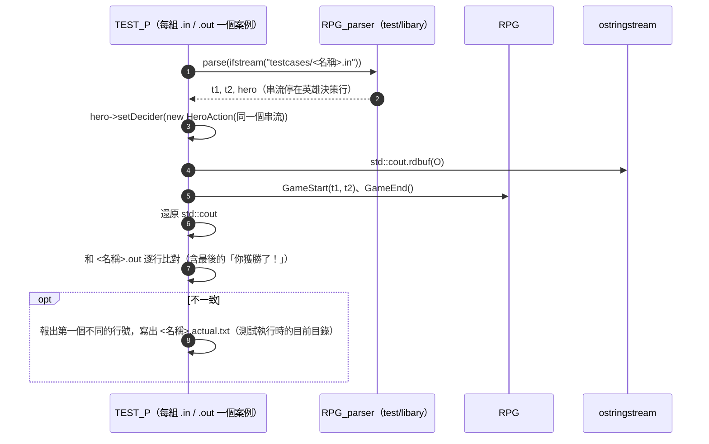

> 這和 `RPGGAME <測資.in>` 走的是同一條路（`main.cpp` 的 `play(file, file)`），所以主程式的輸出也會和 `.out` 相同。
>
> 目前的測試（✅）：`ExampleTests.cpp` 11、`SkillTests.cpp` 43、`RoleTests.cpp` 20、`AIActionTests.cpp` 11、`HeroActionTests.cpp` 15、`StateFlowTests.cpp` 16、`BattleTests.cpp` 10、`ParserTests.cpp` 8、`TestcaseReplayTests.cpp` 11（10 組測資 + 測資清單檢查），共 145 個。每個測試的流程與通過標準見 [`test/TESTS.md`](test/TESTS.md)；輸出用 `rdbuf` 收集（D38）。
