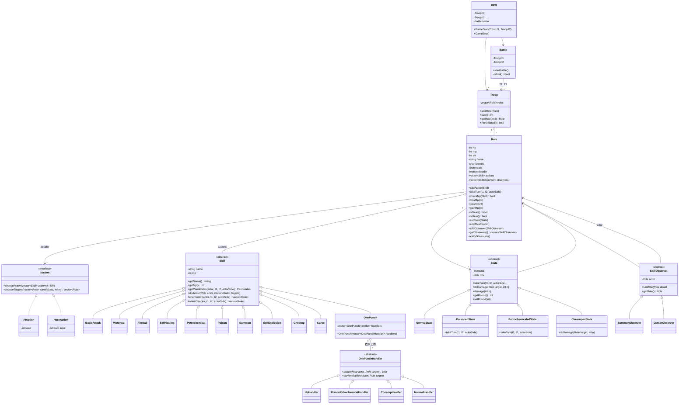
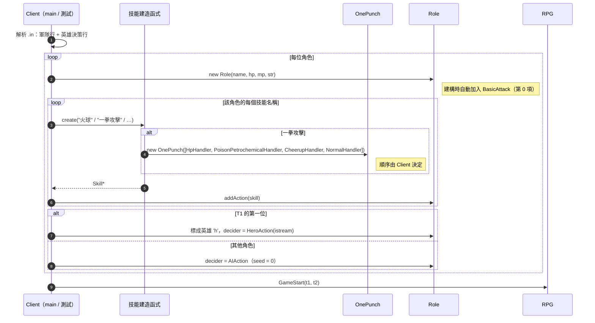
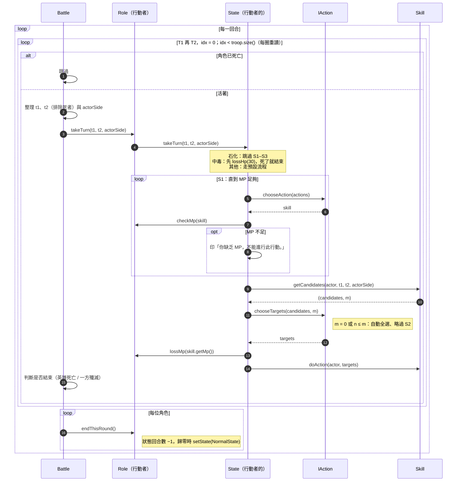
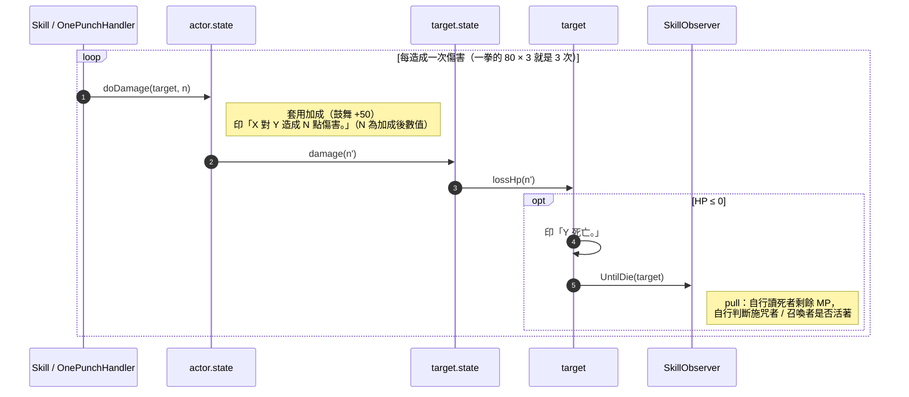
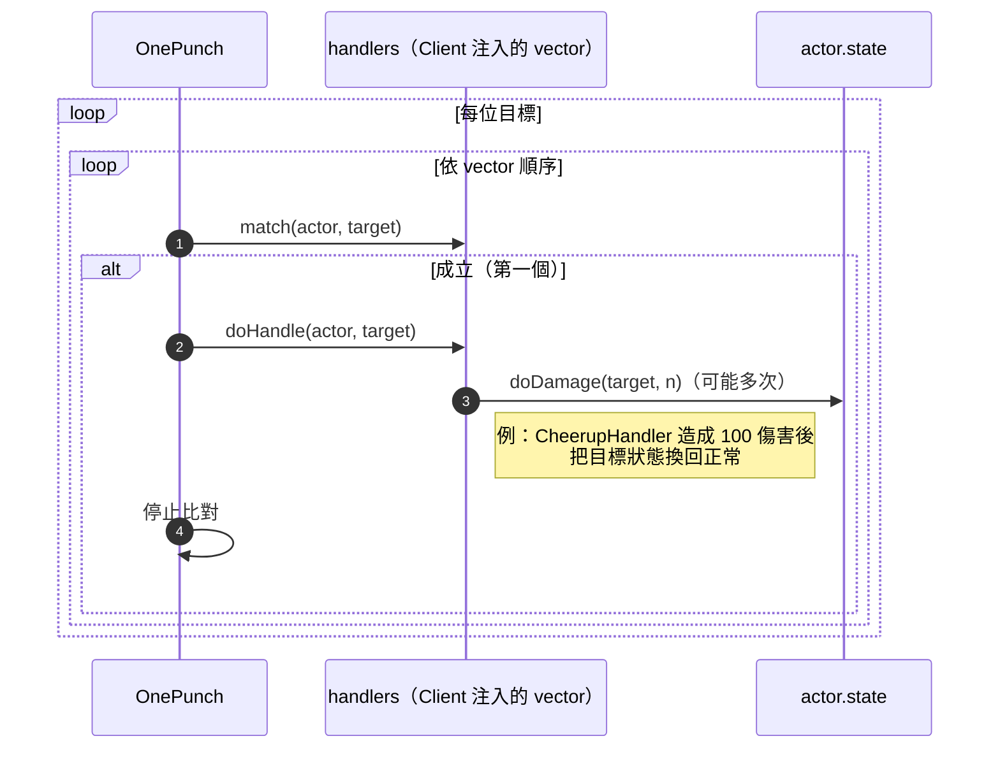
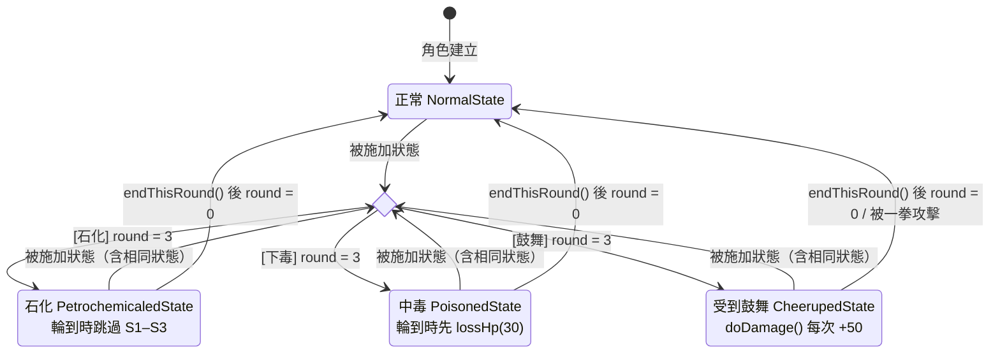
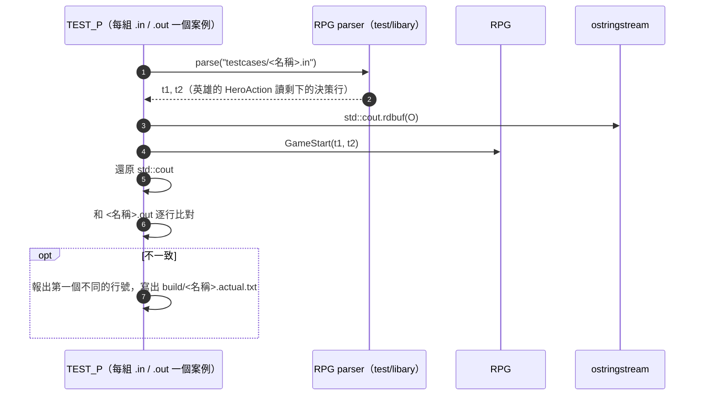

# RPGGame — Diagrams

> **Patterns:** Template Method + State（`State` 主導一次行動的流程）、Strategy（`IAction` 決策者、`Skill` 行動）、Observer（`SkillObserver` 死亡事件）、Chain of Responsibility（`OnePunchHandler`，由 Client 注入）
>
> **依據：** [`CLAUDE.md`](CLAUDE.md) §5 設計決策 D1–D39（2026-10-12 架構設計完成）。本圖畫的是**決定後的設計**，不是目前程式碼的現況；程式碼要到實作階段才會調整。
>
> **方法名稱為暫定**：討論決定的是「責任放在誰身上」，多數方法名稱是為了畫圖暫取的（例如 `takeTurn`、`getCandidates`、`chooseAction`），實作時可以改；沿用自現有程式碼或討論中出現過的名稱（`doAction`、`doDamage`、`lossHp`、`endThisRound`、`checkMp`、`handle`…）保留原名。

| Role | Class |
|---|---|
| 關聯類別（兩軍對戰） | `Battle`（D1） |
| Context（持有狀態與決策者） | `Role` |
| State（Template Method 骨架在抽象類別） | `State` ← `NormalState`、`PoisonedState`、`PetrochemicaledState`、`CheerupedState` |
| Strategy：決策者 | `IAction` ← `AIAction`、英雄的 `IAction`（暫稱 `HeroAction`） |
| Strategy：行動 | `Skill` ← `BasicAttack` + 10 種技能 |
| Observer | `SkillObserver` ← `SummonObserver`、`CurserObserver` |
| Chain of Responsibility | `OnePunchHandler` ← `HpHandler`、`PoisonPetrochemicalHandler`、`CheerupHandler`、`NormalHandler` |

### 與舊版（從程式碼反推的圖）相比的主要改變

| 改變 | 決策 |
|---|---|
| 移除 `Hero` / `AI` 這兩個 `Role` 子類別，改由 `Role` 持有 `IAction`；`seed` 移到 `AIAction` | D4 |
| 一次行動的流程由 `State` 主導，固定流程寫在 `State` 抽象類別 | D10、D12 |
| 傷害一律經過 `actor.state.doDamage()` → `target.state.damage()` → `target.lossHp()` | D16、D17 |
| 觀察者改為 pull model：`UntilDie(dead)` 帶入死者 | D18 |
| 候選名單改由技能計算（`getCandidates`），移除 `targetEnemy` / `targetFriend` | D29、D33 |
| Battle 交給行動流程的是 T1 / T2 活著的角色名單 + 行動者屬於哪一軍 | D30、D31 |
| 一拳攻擊的處理鏈改為 `vector` 並由 Client 注入；handler 介面加入 `actor`；移除 `next` 指標 | D21–D23 |
| handler 用型別判斷狀態，不再比對字串 | D25 |

---

## OOD — 類別圖

**圖中的符號說明**

- `Candidates`：類似 tuple 的（候選名單 `vector<Role*>`, 要選的人數 `m`）（D29）。
- `t1, t2`：Battle 整理好的 T1、T2 名單，**都已排除死者**、各自依隊伍順序；`actorSide`：行動者屬於 T1 還是 T2（D30、D31）。
- `identity`：識別字元，`'h'` 代表英雄（D6）。
- `Skill::getCandidates()` 是 virtual，**預設 = 1 位敵軍**；火球、自我治療、召喚、自爆、鼓舞覆寫它，並呼叫 `enemiesOf` / `alliesOf`（D32、D33）。
- `Role` 建立時自動把 `BasicAttack` 放在 `actions` 第 0 項；Client 只加入輸入檔列出的技能（D28）。
- 每個技能子類別各自持有自己的**中文名稱**，輸出時用 `getName()`（D27）。

### 每個類別負責什麼

| 類別 | 責任 | 決策 |
|---|---|---|
| `RPG` | 註冊兩支軍隊、建立並啟動 `Battle`、接收結果 | D1 |
| `Battle` | 依 T1 → T2、用索引 + 每圈重讀人數輪流（召喚的史萊姆本回合就能行動）、跳過死者；整理 T1 / T2 活著的名單；每次行動後判斷是否結束（英雄死亡 / 一方殲滅）；每回合結束呼叫 `endThisRound()` | D1、D11、D20、D30、D31 |
| `Role` | 持有 State、決策者、行動、觀察者；`checkMp` 只檢查；`lossHp` 是 HP 減少的唯一出口（印死亡、通知觀察者）；回合數歸零時由 Role 換回 `NormalState` | D5、D9、D11、D17 |
| `State` | 固定流程（S1 → MP 檢查 → 算候選 → S2 → 扣 MP → 執行）；`doDamage` 套用行動者的加成並印傷害訊息；`damage` 轉交 `lossHp` | D10、D12、D16 |
| `IAction` | 只做兩個決策：選行動、選目標；n ≤ m 時自動全選也由它判斷（AI 可就地決定 seed 要不要 +1） | D4、D5、D7、D8 |
| `Skill` | 宣告 MP、名稱；計算候選；`doAction` 內每造成一次傷害就呼叫一次 `actor.state.doDamage()` | D3、D16、D29 |
| `SkillObserver` | 收到死者後自行讀資料、自行判斷施咒者 / 召喚者是否還活著 | D18 |
| `Curse` | 從目標的 observer 清單判斷「同一施咒者不疊加」 | D19 |
| `OnePunch` | 對每位目標依序比對 Client 注入的 handler，套用第一個成立的；**沒有預設鏈** | D21–D23 |

### 模組內部 vs 外部擴充（只列已決定的）

| 範圍 | 包含 | 決策 |
|---|---|---|
| **模組內部** | `RPG`、`Battle`、`Troop`、`Role`、`State`、`NormalState`、`IAction`、`Skill`、`BasicAttack`、`SkillObserver` | D1、D11、D28、D32 |
| **外部擴充**（可直接刪檔，不影響模組） | 10 種技能（含 `OnePunch`）、具體的 `OnePunchHandler`；`Curse` / `CurserObserver` 等技能專屬的觀察者；技能帶出的狀態（中毒、石化、鼓舞） | D19、D23、D24、需求 ② |
| **Client** | 讀測資 / 輸入、名稱 → 技能的建造函式、組裝一拳攻擊的處理鏈、建立角色與軍隊、決定每個角色的 `IAction` | D21、D26、D36、D37 |

> 討論中沒有明確決定、圖中暫時這樣畫的：`OnePunchHandler` 抽象類別歸在哪一邊、`AIAction` / `HeroAction` 屬於模組還是 Client、召喚的史萊姆是否保留 `Slime` 子類別（圖中直接用 `Role` 表示）。

---

## OOD — 循序圖：Client 組裝與啟動

> 正式執行時 `HeroAction` 讀 `std::cin`；測試時讀測資檔剩下的英雄決策行（D37）。S1 和 S2 共用同一串輸入。

## OOD — 循序圖：一回合與一次行動

## OOD — 循序圖：傷害、死亡與觀察者

> 中毒扣的 30 HP、自爆的自殺也都經過 `lossHp()`，所以同樣會印死亡、觸發觀察者（D14、D17）。
> 自爆：目標不含自己、依 T1 → T2；對所有目標處理完後，才讓自己 HP 歸零並印「<自己> 死亡。」，自己歸零**不印**傷害訊息（D34，已用 `testcases/self-explosion.out` 驗證）。

## OOD — 循序圖：一拳攻擊（Chain of Responsibility）

> handler 用型別判斷（如 `dynamic_cast`）辨認目標的狀態，不比對字串（D25）；具體 handler 和它們依賴的狀態一起屬於外部擴充（D24）。

## State Diagram — role states（狀態機）

角色身上的狀態效果（State pattern 的 4 個具體狀態）之間**所有的轉移**。

- 菱形是「被施加狀態」的分岔：**任何狀態**（包括已經是同一種狀態）被施加新狀態時，都會覆寫成新狀態並重設 round = 3。
- 石化 / 中毒 / 受到鼓舞在每回合結束時由 `endThisRound()` 把 round − 1，round > 0 時維持原狀態；歸零時由 **Role** 換回正常。
- 任何狀態下 HP ≤ 0 都會死亡（見轉移表最後一列），圖中省略以免線太多。

### 轉移表

| 目前狀態 | 事件 | 條件 | 轉移後 | 動作 / 由誰執行 | 依據 |
|---|---|---|---|---|---|
| 任一狀態（含相同狀態） | 被「石化」命中 | — | 石化 | `target.setState(new PetrochemicaledState)`，round = 3；舊狀態由 Role 釋放 | 需求「覆寫並重新倒數」、D11 |
| 任一狀態（含相同狀態） | 被「下毒」命中 | — | 中毒 | 同上，round = 3 | 同上 |
| 任一狀態（含相同狀態） | 被「鼓舞」選為目標 | — | 受到鼓舞 | 同上，round = 3 | 同上 |
| 石化 / 中毒 / 受到鼓舞 | 回合結束 `endThisRound()`（Battle 呼叫） | round > 1 | 不變 | Role 將 round − 1 | D11 |
| 石化 / 中毒 / 受到鼓舞 | 回合結束 `endThisRound()` | round = 1（−1 後歸零） | 正常 | **Role** 呼叫 `setState(NormalState)`（不由 State 自己換） | D11 |
| 受到鼓舞 | 被一拳攻擊命中 | 不符合「HP ≥ 500」「中毒或石化」 | 正常 | `CheerupHandler` 先造成 100 傷害，再 `setState(NormalState)` | 需求一拳第 3 條、D24 |
| 任一狀態 | `lossHp()` 後 HP ≤ 0 | — | （角色死亡） | 印「X 死亡。」、通知觀察者；之後 Battle 跳過此角色 | D17、D20 |

**round 的計算**（D11）：施加當下的回合算第 1 回合。例：第 1 回合被石化 → round = 3；第 1、2、3 回合結束時各 −1，第 3 回合結束歸零 → 第 4 回合恢復正常，所以第 1、2、3 回合都被跳過。正常狀態沒有 round，不倒數。

## 測試：整場輸入 → 輸出比對（D35–D39）

