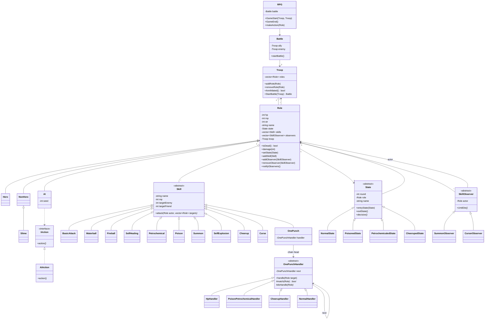
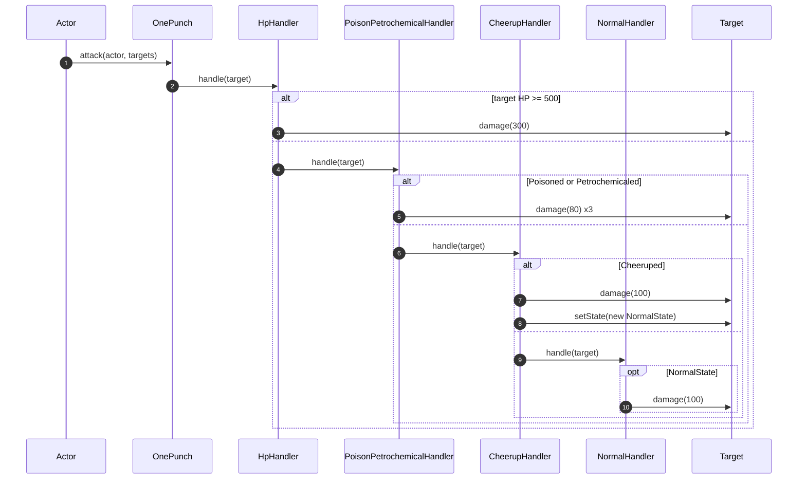
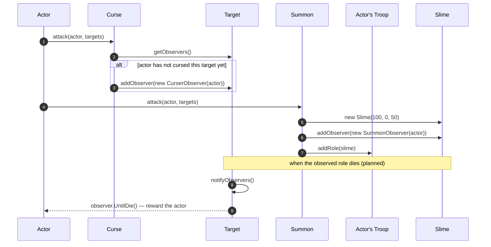
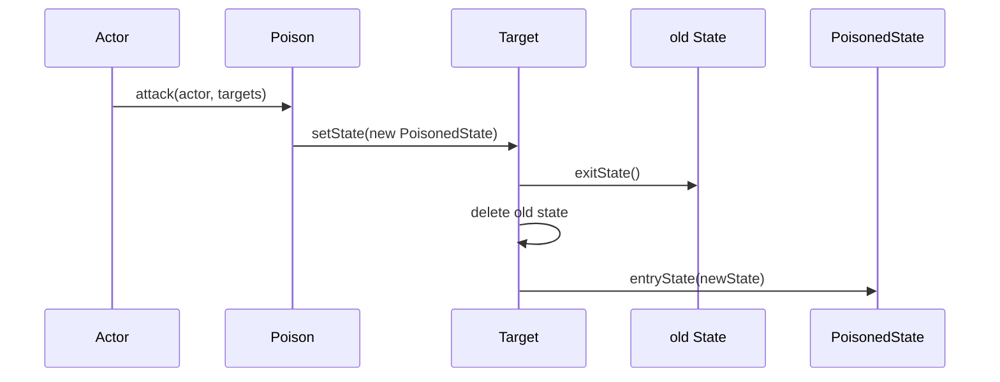

# RPGGame — Diagrams

> **Patterns:** State (`State`) + Observer (`SkillObserver`) + Chain of Responsibility (`OnePunchHandler`) + Strategy (`Skill`, `IAction`)
>
> *Work in progress* — `Battle::startBattle()`, `RPG::makeAction()`, the state `decision()` methods and the observers' `UntilDie()` reactions are still stubs. Diagrams show the implemented parts plus the intended structure.

## Class Diagram

## Sequence Diagram — OnePunch (Chain of Responsibility)

Chain built in `OnePunch()`: `HpHandler → PoisonPetrochemicalHandler → CheerupHandler → NormalHandler`

## Sequence Diagram — Curse and Summon (Observer)

## Sequence Diagram — applying a state

