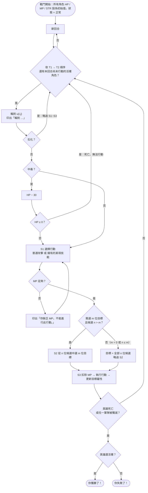
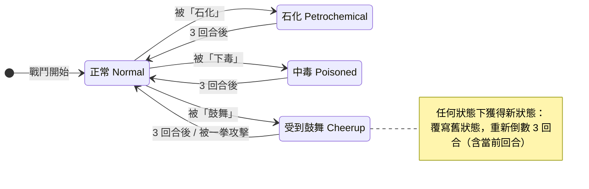
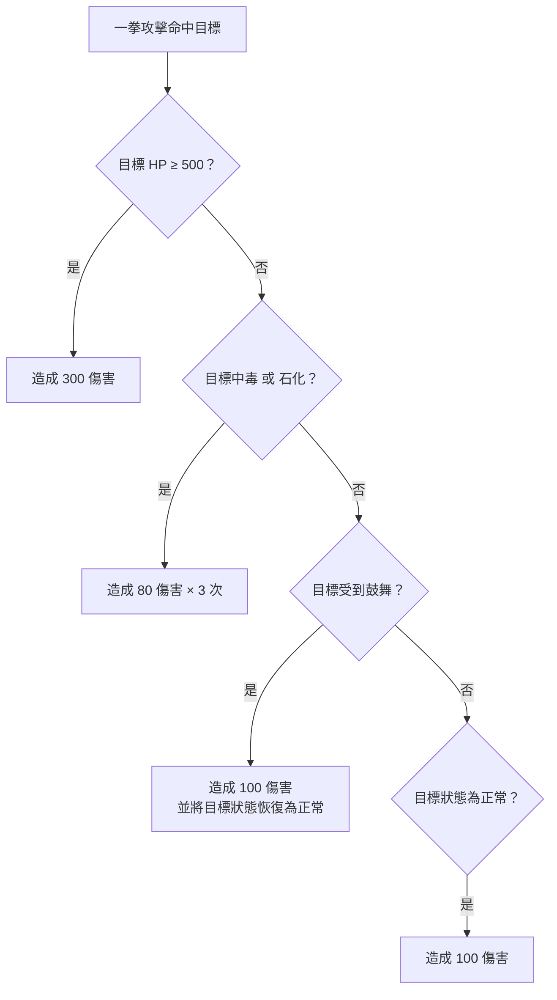

# RPGGame — 需求表

> 本檔由 [`need.txt`](need.txt)（Anthony 貼上的原始需求）轉成 Markdown，**原文文字未更動**，只修正排版（標題層級、粗體與數學式的顯示）。
> 標示 📊 的區塊是 Claude 依需求補畫的示意圖 / 整理表，**只描述需求，不代表任何設計**；標示 📝 的是閱讀時的註記，集中在文末〈需求疑問〉。

## 需求大綱
角色扮演遊戲（Role Playing Game, RPG) 是一種玩家能在劇情中扮演角色、完成任務、過關斬將的遊戲。許多 RPG 遊戲都是「回合制戰鬥系統」，在回合制戰鬥系統中，雙方人馬（敵方與友方）對戰，並且雙方的每一位戰士會輪流戰鬥，直到全數殲滅對方。戰鬥的方式分為兩種：攻擊對方的一位戰士，或是消耗自身魔力，使用特殊的戰鬥技能。

## 詞彙表 (Glossary)
這一次我們仍然幸運，遊戲廠商的專案管理者也具備高度軟工素養，十分熟悉領域驅動設計 (Domain-Driven Design) 的觀念，他知道要與開發團隊建立一致認同的語言 (Ubiquitous Language) 才能大幅地提升合作效率。因此，這份需求中也體貼地替你準備了相關詞彙表 (Glossary)，也許你可以先速讀一下每個專有名詞在 RPG 領域中的對應概念，再往下閱讀詳細的遊戲規則。閱讀規則時如有疑惑可以再回到詞彙表中查詢相關概念。

1. **角色扮演遊戲 (RPG)**：在本需求中指開發的目標程式，基於回合制戰鬥系統的角色扮演遊戲。
2. **角色 (Unit or Role)**： RPG 中的一位可戰鬥實體；每位角色都有著以下屬性：生命值 (Health Point, HP)、魔力值 (Magic Point, MP)、攻擊力 (Strength, STR)、狀態 (State)、 名字 (Name) 以及多個技能 (Skills)。
3. **軍隊 (Troop)**：每一場戰鬥都涉及了兩方軍隊，而每一方軍隊都由多位角色組隊而成（至少一位）。
4. **英雄 (Hero)**：由玩家親自操控的特殊角色，被稱之為英雄。在 RPG 中只會有一位玩家，因此只會有一位英雄。英雄待在其中一方軍隊中。
5. **戰鬥 (Battle)**：一場兩個軍隊互相對戰直到某方被殲滅為止的活動。
6. **殲滅 (Annihilate)**：如果軍隊中所有參戰角色都已死亡，則可稱該軍隊已被殲滅 (Annihilated)。
7. **技能 (Skill)**：角色具備且能讓角色在戰鬥中做出某種效果的特殊行動 (Action)，效果非常多元。
8. **友軍 (Ally)**：在同一個軍隊中的另外一位角色。
9. **敵軍 (Enemy)**：在不同軍隊中的另外一位角色。
10. **傷害（Damage a Unit)**：指能減少角色生命值的行為，如果傷害值為 100，則會將受到傷害的角色的生命值減少 100。
11. **死亡的 (Dead)**：生命值 (HP) ≤ 0。
12. **活著的 (Alive)**：生命值 (HP) > 0。

## 遊戲流程 (Game Flow)
1. 在 RPG 中，有兩方軍隊互相對戰。
    1. 在本需求中，我們將使用 $T_1,T_2$ 表示兩方軍隊，並且使用 $u_{i,1},u_{i,2}...u_{i,n_i}$ 表示 $T_{i}$軍隊中的所有角色，其中 *i*∈{1, 2}，並且 $n_i$ 表示軍隊 $T_i$ 的角色數量。舉例來說：$u_{1,4}$ 為第 1 個軍隊 $T_1$ 中的第 4 個角色
    2. 玩家所操控的英雄（標示為 $h$ ）為軍隊 $T_1$ 的第一位角色， $i.e.,h=u_{1,1}$ 。其他角色受 AI 自動操控。
    3. 舉例：如果有兩方軍隊，且第一方軍隊有三位角色，第二方軍隊有四位角色，則我們$T_1=u_{1,1},u_{1,2},u_{1,3}$ $T_2=u_{2,1},u_{2,2},u_{2,3},u_{2,4}$。
2. 戰鬥流程：
    1. 戰鬥開始時，每位角色的 HP、MP、STR 值都將被設為初始值，並且狀態為「正常狀態 (Normal State)」。
    2. 在戰鬥的每一回合 (Round) 中，每一位活著的角色將會輪流執行一個行動 (Action)，輪流的順序為 $(u_{1,1},u_{1,2},u_{1,n1}，u_{2,1},u_{2,2},u_{2,n1})$，意即，軍隊一中活著的角色先依照順位行動，再換軍隊二中活著的角色依順位行動。（不會輪到已死亡的角色）
        1. 每一位活著的角色行動完之後，該回合就會結束，並且開始下一回合。
    3. 當輪到角色 $u_{i,j}$時，$u_{i,j}$ 執行：
        - **(S1) 選擇一個行動：** 這個行動只有兩種 — 基本攻擊 (Basic Attack)，或是 $u_{i,j}$ 擁有的其中一項技能。在行動時，由於有些行動會要求消耗角色的 MP，因此在執行行動前，RPG 會先檢查 $u_{i,j}$ 是否有足夠的 MP 來執行該行動，如果不具備足夠的 MP，則此行動被視為是「不合法」的，此時 RPG 會再請一次 *ui*, *j* 做出 S1 的選擇直到他選擇合法的行動為止。
        - **(S2) 選擇目標：** 如果在 S1 選擇的行動需要「選定 $m$ 位目標角色 (Targets)」，並且，戰場上留存的合法候選角色 (Candidates) 的數量 $n$ 大於 $m$，那麼 RPG 會要求 $u_{i,j}$ 從這 $n$ 位候選角色中選擇 $m$ 位作為該行動的目標角色；如果此行動無須選擇目標（意即 $m=0$，或是 $n<=m$），則 RPG 會自動決定目標為該留存的 $n$ 位候選角色並且略過 S2 （但仍會執行 S3）。
        - **(S3) 執行行動：** 在做完 S1 和 S2 兩個選擇之後，RPG 會先向 $u_{i,j}$ 扣除此行動所需的 MP，再執行 $u_{i,j}$  選擇的行動，並將行動的效果更新在其目標角色的屬性上。
    - 當 **S3** 結束後，RPG 會檢查此場戰鬥是否結束。如果 (1) 英雄 $h$ 死亡，或是 (2) 其中一方軍隊已被殲滅，則戰鬥結束；否則戰鬥繼續。
    - 當戰鬥結束後，遊戲勝負揭曉 — 如果英雄 $h$ 仍然活著，玩家獲勝；否則玩家失敗。


#### 📊 流程示意（依需求繪製，不代表設計）



> 📝 圖中「中毒致死後直接輪下一位」與「結束檢查只在 S3 後」皆依原文；中毒致死後是否立即檢查結束，原文未明說，見文末〈需求疑問〉Q2。

### 角色狀態 (States)
角色初始的狀態為「正常 (Normal State)」，而除了正常狀態，其他狀態都將會改變角色在各種戰鬥中各種時機的行為。目前有以下三種狀態：

1. **石化 (Petrochemical)**：角色在此輪中無法行動，意即，此角色在此輪中的 S1、 S2 和 S3 將會被略過。
2. **中毒 (Poisoned)**：輪到此角色時，此角色在進入 S1 階段前的 HP 會減少 30，如果 HP 減少後角色 HP 歸零，則此角色死亡且無法行動。
3. **受到鼓舞 (Cheerup)：** 此角色在執行每一個能造成傷害的行動中，對於每一位被傷害者都額外創造 50 滴 HP 的加成傷害。

### 行動 (Actions)
此章節列出所有角色的合法行動。我們稱「執行此行動」的角色為行動角色，並標示 ＊ 的行動代表其要求選擇特定數量的目標。

1. **普通攻擊 (BasicAttack)：** (MP: 0 — 目標： 1 位敵軍＊) - 對目標角色造成值為行動角色 STR 的傷害。（例如：如果行動角色的 STR 為 100，則會對目標角色造成 100 傷害）
2. **技能清單 (Skills)：**
    1. **水球 (Waterball)：** (MP: 50 — 目標：1 位敵軍＊) - 對目標角色造成 120 點傷害。
    2. **火球 (Fireball)：** (MP: 50 — 目標：所有敵軍) - 對所有目標角色造成 50 點傷害。
    3. **自我治療 (SelfHealing)：** (MP: 50 — 目標：自己) - 增加目標角色（也就是此行動角色自己） 150 點 HP。
    4. **石化 (Petrochemical)：** (MP: 100 — 目標：1 位敵軍＊) - 使目標角色獲得三回合的石化狀態（包含當前回合）
    5. **下毒 (Poison)：** (MP: 80 — 目標： 1 位敵軍＊) - 使目標角色獲得三回合的中毒狀態（包含當前回合）
    6. **召喚 (Summon)：** (MP: 150 — 目標： 無) - 召喚一位「史萊姆 (Slime)」 角色。史萊姆擁有 100 HP、0 MP、50 STR，沒有任何技能，並且初始為正常狀態。此史萊姆角色將會加入行動角色所屬軍隊的尾端，並且，在此回合中史萊姆已能開始行動。
        1. 另外，當史萊姆死亡時且召喚者仍活著，召喚者可以增加 30 點 HP。
    7. **自爆 (SelfExplosion)：** (MP: 200 — 目標：戰場上所有角色) - 行動角色自殺（行動角色生命值歸零），並且對戰場上所有角色造成 150 點傷害。
    8. **鼓舞 (Cheerup)：** (MP: 100 — 目標：3 位友軍＊) - 使所有目標角色獲得三回合的受到鼓舞狀態（包含當前回合）
    9. **詛咒 (Curse)：** (MP: 100 — 目標： 1 位敵軍＊) - 目標角色會受到來自於行動角色的詛咒。當受詛咒者死亡時且施咒者仍活著，施咒者的 HP 將會被加上受詛咒者的剩餘 MP。每一位角色都可能受到多次詛咒。如果詛咒是來自於同一位施咒者，效果並不會疊加；而如果詛咒是來自於不同位施咒者，則每一位施咒者都將在受詛咒者死亡時獲得相同數量的剩餘 MP。
        1. 舉例來說：如果有一位角色依序受到來自於角色 $A,B,A$ 詛咒，當此角色在剩餘 60 MP 時死亡，角色 $A,B$ 的 HP 立即依序增加 60 滴。
    10. **一拳攻擊 (OnePunch)：** (MP: 180 — 目標：1 位敵軍＊) - 依據目標角色的當前狀態，而有不同的效果，效果只會為以下清單中的其中一種，從上往下依序比對每一項成立條件，並選擇第一項符合條件的效果：
        1. 如果目標角色的生命值 ≥ 500，直接對目標角色造成 300 點傷害。
        2. 如果目標角色的當前狀態為中毒狀態或是石化狀態，對目標角色造成三次 80 點傷害。
        3. 如果目標角色的當前狀態為受到鼓舞狀態，對目標角色造成 100 點傷害，並將目標角色的狀態恢復成正常狀態。
        4. 如果目標角色的當前狀態為正常狀態，對目標角色造成 100 點傷害。

有多項技能都能「改變角色三回合內的狀態」，由於每個角色最多只能處於一種狀態之下，每當角色獲得新的狀態時，就會覆寫舊有狀態，並且重新倒數三回合（含當前回合）。三回合過後（含當前回合），角色的狀態會還原到正常狀態。


#### 📊 狀態示意（依需求繪製，不代表設計）



| 狀態 | 何時生效 | 效果 |
|---|---|---|
| 正常 | — | 無 |
| 石化 | 輪到該角色時 | 略過 S1、S2、S3（仍要印出「輪到 …」） |
| 中毒 | 輪到該角色、進入 S1 前 | HP − 30；若因此死亡則無法行動 |
| 受到鼓舞 | 執行會造成傷害的行動時 | 對每位被傷害者額外 + 50 傷害 |


#### 📊 行動一覽表（整理自上文）

| 行動 | MP | 目標 | 需選目標 ＊ | 效果 |
|---|---|---|---|---|
| 普通攻擊 | 0 | 1 位敵軍 | ＊ | 造成「行動角色 STR」點傷害 |
| 水球 | 50 | 1 位敵軍 | ＊ | 120 傷害 |
| 火球 | 50 | 所有敵軍 | | 每位 50 傷害 |
| 自我治療 | 50 | 自己 | | HP + 150 |
| 石化 | 100 | 1 位敵軍 | ＊ | 石化 3 回合（含當前） |
| 下毒 | 80 | 1 位敵軍 | ＊ | 中毒 3 回合（含當前） |
| 召喚 | 150 | 無 | | 史萊姆（100 HP / 0 MP / 50 STR）加入己方隊尾，本回合即可行動；史萊姆死亡且召喚者活著 → 召喚者 HP + 30 |
| 自爆 | 200 | 戰場上所有角色 | | 自己 HP 歸零，並對所有目標造成 150 傷害 |
| 鼓舞 | 100 | 3 位友軍 | ＊ | 受到鼓舞 3 回合（含當前） |
| 詛咒 | 100 | 1 位敵軍 | ＊ | 受詛咒者死亡且施咒者活著 → 施咒者 HP + 受詛咒者剩餘 MP；同一施咒者不疊加，不同施咒者各自獲得 |
| 一拳攻擊 | 180 | 1 位敵軍 | ＊ | 依下圖由上而下比對，套用第一個成立的效果 |



## AI 決策
英雄以外的角色將會由 AI 操控，為了簡化需求，AI 的決策方式非常簡單：

每位 AI 將會存有一個 seed 屬性，初始值為 0，每位 AI 依賴自己的 seed 屬性來做各項決策，每次做完一項決策，seed 的值就會 + 1。

在 S1 階段中，AI 會選擇第 `seed % 行動數量` 個行動。舉例來說，當輪到某 AI 且其 seed=0 且擁有四項技能。則此 AI 會選擇第 0 項行動（普通攻擊），而如果 seed=1，則 AI 會選擇第 1 項行動（也就是技能 1），如果 AI 不具備足夠 MP 來執行技能 1，則 AI 會被迫再決定一次行動，此時 seed=2，因此 AI 會選擇第 2 項行動，以此類推，直到 AI 選擇了合法的行動為止。

而在 S2 階段中，AI 可能需要選擇一到多位目標角色。假設 AI 要選擇 $m$ 位目標角色，而候選角色有 $n$ 位，分別是 $(u_{1},u_{2},...,u_{N})$，另 $s$ 為 AI 當前的 seed 值，則 AI 會選擇 $(u_{s\%n},u_{(s+1)\%n}, ..., u_{(s+m)\%n})$ 作為目標角色，選擇完所有目標角色後 seed 的值才會加一。舉例來說：如果 seed=2、候選角色有三名：(A, B, C)，且 AI 要選擇 2 名目標角色，則他會選擇 (C, A)，選完之後 seed=3。

> 📝 原文公式寫 $u_{(s+m)\%n}$，但依範例（seed = 2、候選 (A, B, C)、選 2 位 → (C, A)）推算，最後一位應為 $u_{(s+m-1)\%n}$，共 m 位。見文末〈需求疑問〉Q1。

#### 📊 AI 決策示意（依原文範例）

| 決策 | 規則 | 範例 |
|---|---|---|
| S1 選行動 | 選第 `seed % 行動數量` 個（0 = 普通攻擊），選完 seed + 1；MP 不足就用新的 seed 再選 | seed = 1、有 4 項技能 → 選技能 1；MP 不足 → seed = 2 → 選技能 2 |
| S2 選目標 | 從候選 $(u_1 … u_n)$ 選 $u_{s\%n}$ 起連續 m 位，**全部選完** seed 才 + 1 | seed = 2、候選 (A, B, C)、選 2 位 → (C, A)，之後 seed = 3 |


AI 必須完全遵照此規則實作，才能與測資有相符的行為結果。

## 設計需求 (Design Requirement)
你所開發的 RPG 模組程式必須在支援以下變動時遵守著開閉原則 (Open-Close Principle)，意即，你開發的模組允許 Client 自外部支援以下變動而不必修改 RPG 模組內部程式碼：

1. 擴充新的 AI 實作
2. 支援新的角色技能或是刪除既有角色技能
    - 此項的意思為：開發者應能直接刪除該技能的類別檔案，也完全不會影響到 RPG 模組的運作，而如果開發者有意擴充新技能時，應也能直接自模組外部擴充，完全無須修改模組程式碼。
    - 注意， 支援新的角色技能時，很有可能會需要支援新的「角色狀態」，因此角色狀態的擴充也需要遵守 OCP，而開發者也需要針對新的狀態擴充新的行為至「一拳攻擊」之中。
        - 「一拳攻擊」的攻擊行為並不只是根據目標角色的狀態，也有可能根據其他目標角色的屬性。

**Tip：為了做到遵守 OCP，必須套用適當的行為型模式來做出精準的依賴反轉，並將行為變種依賴注入至模組之中。**

## 輸入格式
```bash
#軍隊-1-開始
<軍隊-1>
#軍隊-1-結束
#軍隊-2-開始
<軍隊-2>
#軍隊-2-結束
<英雄決策-1>
<英雄決策-2>
<英雄決策-3>
...

```

`<軍隊-1>` 和 `<軍隊-2>` 中包含多個 `<角色>` ，每個 `<角色>` 都獨佔一行，此行的內容為以下：

- `<角色> = <名稱> <HP> <MP> <STR> <技能-1> <技能-2> <技能-3> ... <技能-K>`
    - 其中，`<HP>`, `<MP>` 和 `<STR>` 是角色的 HP、MP 和 STR （保證為非負整數）。
    - `<名稱>` 則為此角色的名稱，名稱為包含多個字母或是數字的字串。
    - 所有的 `<技能-k>` (k = 1, …, K) 為此角色擁有的技能清單。`<技能-k>` 的內容只能是「水球、火球、自我治療、石化、下毒、召喚、自爆、鼓舞、詛咒、一拳攻擊」其中一項。
- `<軍隊-1>` 中的第一個 `<角色>`保證為英雄 （$u_{1,1}$），此角色的名稱必為 Hero。
- 英雄以外的角色將會由 AI 操控，AI 的決策方式請參考 【 AI 決策行為 】章節。而英雄的決策則源自於測資中的每一行`<英雄決策-i>` ，`<英雄決策-i>` 代表英雄做的第 i 個決策（可能是在 S1 階段時選擇行動時所做的決策，或者是在 S2 階段時選擇目標角色所做的決策）。
    - 每一個 `<英雄決策-i>` 為單獨的一行，為以 “, “（逗號加一個空白）相隔的多個數字（例如：`1, 2, 3, 4`）。為了簡化測資，測資保證 `<英雄決策-i>` 會包含正確數量個數字，並且其中的每一個數字都處於合法的數字範圍內。儘管如此，`<英雄決策-i>` 還是有可能因為英雄不具備足夠的 MP、被視為非法行動而被要求再次決策（即`<英雄決策-i+1>` ）。

## 輸出格式
- 為了能夠在輸出中有效辨識角色的所屬軍隊，每個角色的名稱在輸出中都帶有一個數字前綴，如果角色屬於軍隊 1，則此前綴為 `[1]`，如果角色屬於軍隊 2，則此前綴為 `[2]` 。例如：`[1]Hero,` `[2]Boss` 。
- 當輪到某一位非死角色時，首先印出一行：`輪到 <角色名稱> (HP: <HP>, MP: <MP>, STR: <STR>, State: <狀態>)。`
    - `<角色名稱>`, `<HP>`, `<MP>`, `<STR>` 和 `<狀態>` 為角色的名稱、HP、MP、STR 和狀態。`<狀態>` 的值只可能為 正常, 石化, 中毒, 受到鼓舞 中其中一項。
        - 注意：當輪到一位被石化 (Petrochemical) 的角色時，即使此角色的回合將會礙於石化效果而被跳過，但由於此角色尚未死亡，依然要印出此行訊息。
- 在輪到某角色並進入階段 S1 時，輸出以下此行訊息來請該角色選擇一項行動：`選擇行動：(0) 普通攻擊 (1) <技能-1> (2) <技能-2> ... (<K>) <技能-K>`
    - `<K>` 代表該角色擁有的技能數量，而對於所有 k = 1, …, K，`<技能-K>` 為該角色的第 k 項技能名稱。
- 在進入階段 S2 時，如果此為英雄的回合，輸出一行訊息來請英雄玩家從候選角色中選擇目標角色：`選擇 <m> 位目標: (0) <候選-1> (1) <候選-2> ... (<n-1>) <候選-n>`
    - `<m>` 為行動要求的目標角色數量。
    - 對於所有 $j=1,...,n$之間，`<候選-j>` 是第 $j$ 位合法候選目標角色的名稱。候選目標角色的排序遵守著 $(u_{1,1},u_{1,2},...u_{1,n1}，u_{2,1},u_{2,2},...,u_{2,n2})$。
- 在進入階段 S3 時，如果此行動為**普通攻擊**，則輸出一行訊息： `<角色> 攻擊 <目標>。` ；如果此行動為自我治療，則輸出一行訊息：`<角色> 使用了 <技能>。` ；除此之外則輸出一行訊息：`<角色> 對 <目標角色清單> 使用了 <技能>。`
    - `<角色>` 是行動角色的名稱、`<技能>` 是此角色使用的技能名稱、`<目標>` 為單一目標角色的名稱，而 `<目標角色清單>` 包含多位目標角色的名稱（以逗號+一個空白隔開），例如：[1]Hero, [1]Catwoman, [1]Robin。
    - 如果此行動能傷害目標角色，每一位目標角色依照 $(u_{1,1},u_{1,2},...u_{1,n1}，u_{2,1},u_{2,2},...,u_{2,n2})$ 這個順序接受傷害，並在傷害時輸出一行訊息：`<角色> 對 <目標> 造成 <傷害值> 點傷害。`
        - `<傷害值>` 是目標角色受到的傷害值。如果在受到傷害之後該目標角色死亡，則再輸出一行訊息：`<目標> 死亡。`
- 在階段 S1 中，如果角色礙於 MP 不足而無法進行某行動，輸出一行訊息：`你缺乏 MP，不能進行此行動。`
- 當遊戲結束時，如果玩家（英雄方）勝利，輸出一行訊息：`你獲勝了！` ，否則輸出一行訊息：`你失敗了！`

## 範例輸入 (Example Input)
```
#軍隊-1-開始
英雄 300 500 100 火球 水球
#軍隊-1-結束
#軍隊-2-開始
Slime1 200 60 49 火球
Slime2 200 200 50 火球 水球
#軍隊-2-結束
1
2
1
2
1
2
1

```

## 範例輸出 (Example Output)
```
輪到 [1]英雄 (HP: 300, MP: 500, STR: 100, State: 正常)。
選擇行動：(0) 普通攻擊 (1) 火球 (2) 水球
[1]英雄 對 [2]Slime1, [2]Slime2 使用了 火球。
[1]英雄 對 [2]Slime1 造成 50 點傷害。
[1]英雄 對 [2]Slime2 造成 50 點傷害。
輪到 [2]Slime1 (HP: 150, MP: 60, STR: 49, State: 正常)。
選擇行動：(0) 普通攻擊 (1) 火球
[2]Slime1 攻擊 [1]英雄。
[2]Slime1 對 [1]英雄 造成 49 點傷害。
輪到 [2]Slime2 (HP: 150, MP: 200, STR: 50, State: 正常)。
選擇行動：(0) 普通攻擊 (1) 火球 (2) 水球
[2]Slime2 攻擊 [1]英雄。
[2]Slime2 對 [1]英雄 造成 50 點傷害。
輪到 [1]英雄 (HP: 201, MP: 450, STR: 100, State: 正常)。
選擇行動：(0) 普通攻擊 (1) 火球 (2) 水球
選擇 1 位目標: (0) [2]Slime1 (1) [2]Slime2
[1]英雄 對 [2]Slime2 使用了 水球。
[1]英雄 對 [2]Slime2 造成 120 點傷害。
輪到 [2]Slime1 (HP: 150, MP: 60, STR: 49, State: 正常)。
選擇行動：(0) 普通攻擊 (1) 火球
[2]Slime1 對 [1]英雄 使用了 火球。
[2]Slime1 對 [1]英雄 造成 50 點傷害。
輪到 [2]Slime2 (HP: 30, MP: 200, STR: 50, State: 正常)。
選擇行動：(0) 普通攻擊 (1) 火球 (2) 水球
[2]Slime2 對 [1]英雄 使用了 火球。
[2]Slime2 對 [1]英雄 造成 50 點傷害。
輪到 [1]英雄 (HP: 101, MP: 400, STR: 100, State: 正常)。
選擇行動：(0) 普通攻擊 (1) 火球 (2) 水球
選擇 1 位目標: (0) [2]Slime1 (1) [2]Slime2
[1]英雄 對 [2]Slime2 使用了 水球。
[1]英雄 對 [2]Slime2 造成 120 點傷害。
[2]Slime2 死亡。
輪到 [2]Slime1 (HP: 150, MP: 10, STR: 49, State: 正常)。
選擇行動：(0) 普通攻擊 (1) 火球
[2]Slime1 攻擊 [1]英雄。
[2]Slime1 對 [1]英雄 造成 49 點傷害。
輪到 [1]英雄 (HP: 52, MP: 350, STR: 100, State: 正常)。
選擇行動：(0) 普通攻擊 (1) 火球 (2) 水球
[1]英雄 對 [2]Slime1 使用了 水球。
[1]英雄 對 [2]Slime1 造成 120 點傷害。
輪到 [2]Slime1 (HP: 30, MP: 10, STR: 49, State: 正常)。
選擇行動：(0) 普通攻擊 (1) 火球
你缺乏 MP，不能進行此行動。
選擇行動：(0) 普通攻擊 (1) 火球
[2]Slime1 攻擊 [1]英雄。
[2]Slime1 對 [1]英雄 造成 49 點傷害。
輪到 [1]英雄 (HP: 3, MP: 300, STR: 100, State: 正常)。
選擇行動：(0) 普通攻擊 (1) 火球 (2) 水球
[1]英雄 對 [2]Slime1 使用了 火球。
[1]英雄 對 [2]Slime1 造成 50 點傷害。
[2]Slime1 死亡。
你獲勝了！
```

---

## 📝 需求疑問（Claude 閱讀時的註記，非原文）

以下只是閱讀需求時發現不清楚或疑似筆誤的地方，**需求本身以原文為準**，實際如何解讀由 Anthony 決定。

| # | 位置 | 疑問 |
|---|---|---|
| Q1 | AI 決策 S2 | 公式寫到 $u_{(s+m)\%n}$ 會選出 m + 1 位；範例只選 2 位 (C, A)，看起來應為 $u_{(s+m-1)\%n}$。 |
| Q2 | 遊戲流程 / 中毒 | 結束檢查只寫在 S3 之後。若英雄（或某軍最後一人）因中毒在 S1 前死亡，是立即結束，還是等下一個角色的 S3 之後才判定？ |
| Q3 | 遊戲流程 2.2 | 輪流順序寫成 $(u_{1,1}, …, u_{1,n1}, u_{2,1}, …, u_{2,n1})$，第二段應為 $u_{2,n2}$。 |
| Q4 | 輸入格式 vs 範例 | 原文說英雄的名稱「必為 Hero」，但範例輸入使用「英雄」。 |
| Q5 | 自爆 | 目標為「戰場上所有角色」：是否包含行動角色自己？輸出「對 <目標角色清單> 使用了 自爆」時，清單裡要不要列出自己？ |
| Q6 | 鼓舞 | 「3 位友軍」是否包含自己？友軍的定義是「同一軍隊中的**另外一位**角色」，看起來不含自己。 |
| Q7 | 角色狀態 / 石化、下毒、鼓舞 | 「三回合（含當前回合）」：若目標在本回合**已經行動過**才被施加狀態，當前回合是否仍算 1 回合？倒數是以「回合結束」還是「該角色自己的回合」為單位？兩種算法在這個情況下結果不同。<br>**Anthony 的解讀**：施加當下的回合一律算 1 回合（即使已行動過），每回合結束時 −1。 |
| Q8 | 受到鼓舞 / 一拳攻擊、自爆 | 「每一位被傷害者額外 +50」：一拳攻擊對同一目標「造成三次 80 點傷害」時，是加一次 50 還是每次都加？自爆時行動角色「自殺（生命值歸零）」算不算一次傷害、要不要加 50？輸出的「造成 X 點傷害」是否為加成後的數值？<br>**Anthony 的解讀**：一拳攻擊每次都 +50；自爆的自殺算一次傷害；輸出加成後的數值。 |
