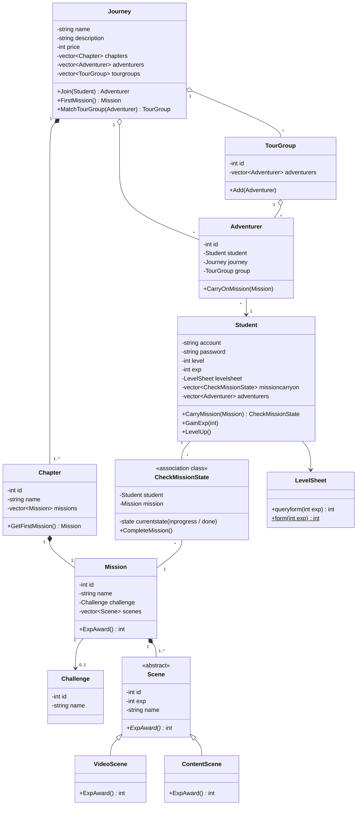
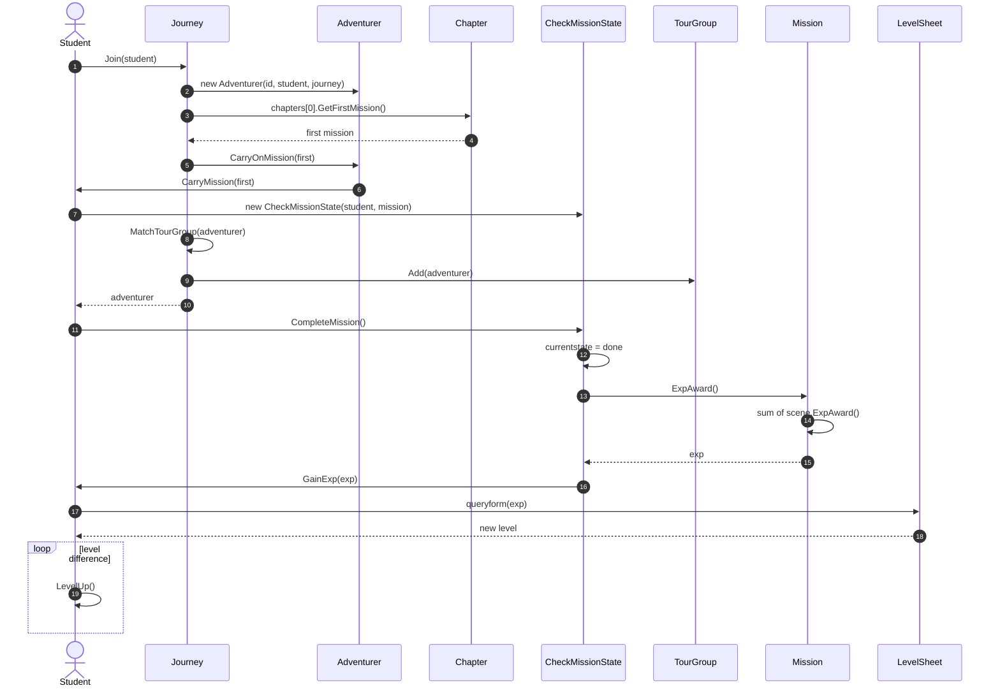

# WaterBallSchool — Diagrams

> **Focus:** OOA domain model (aggregation hierarchy, association class, abstract scene)

## Class Diagram

## Sequence Diagram — a student joins a journey and completes a mission

