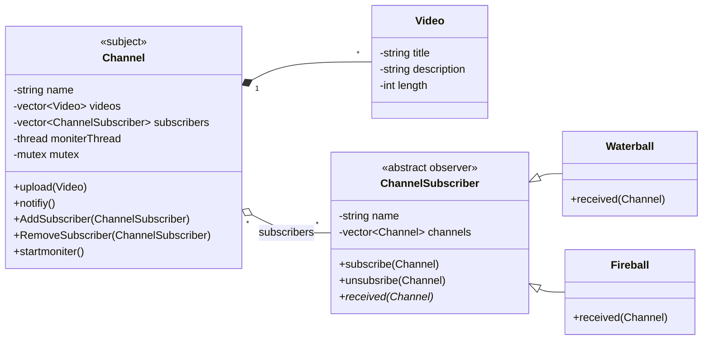
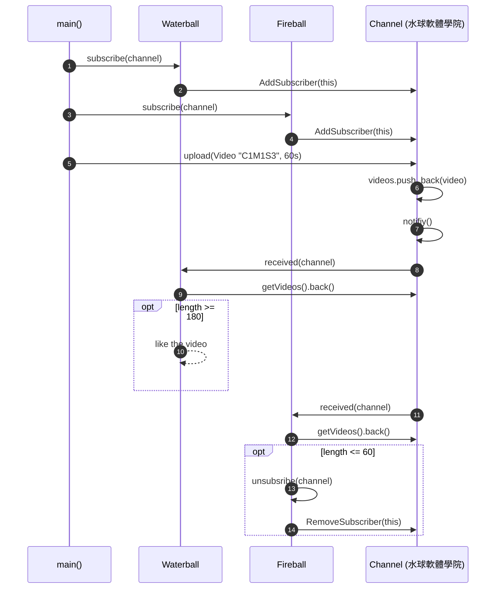

# YtChannel — Diagrams

> **Pattern:** Observer (`Channel` = subject, `ChannelSubscriber` = observer)

## Class Diagram

## Sequence Diagram — subscribe, upload, notify

> The channel only knows the abstract `ChannelSubscriber::received()`. Each subscriber decides its own reaction.
