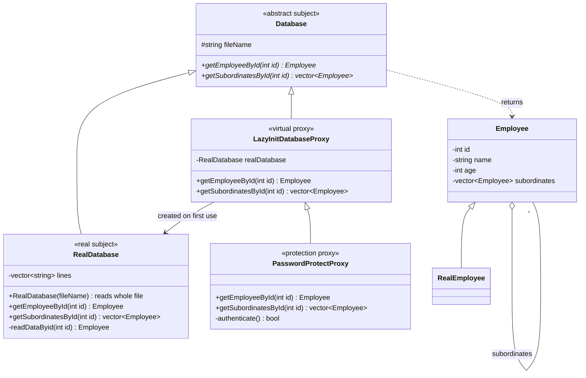
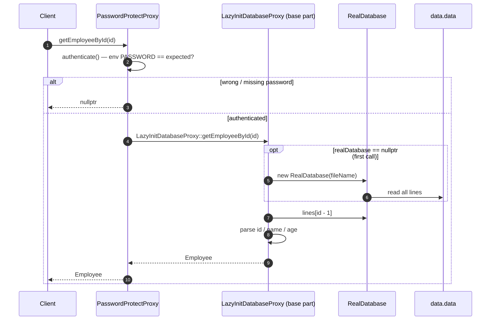

# employee — Diagrams

> **Pattern:** Proxy (virtual proxy + protection proxy)

| Role | Class |
|---|---|
| Subject | `Database` |
| Real subject | `RealDatabase` |
| Virtual proxy | `LazyInitDatabaseProxy` |
| Protection proxy | `PasswordProtectProxy` |

## Class Diagram

## Sequence Diagram — protected, lazily-loaded lookup

> Both proxies keep the `Database` interface, so the client cannot tell whether it talks to the real database or a proxy.
