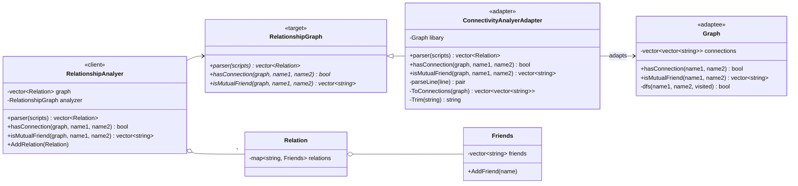
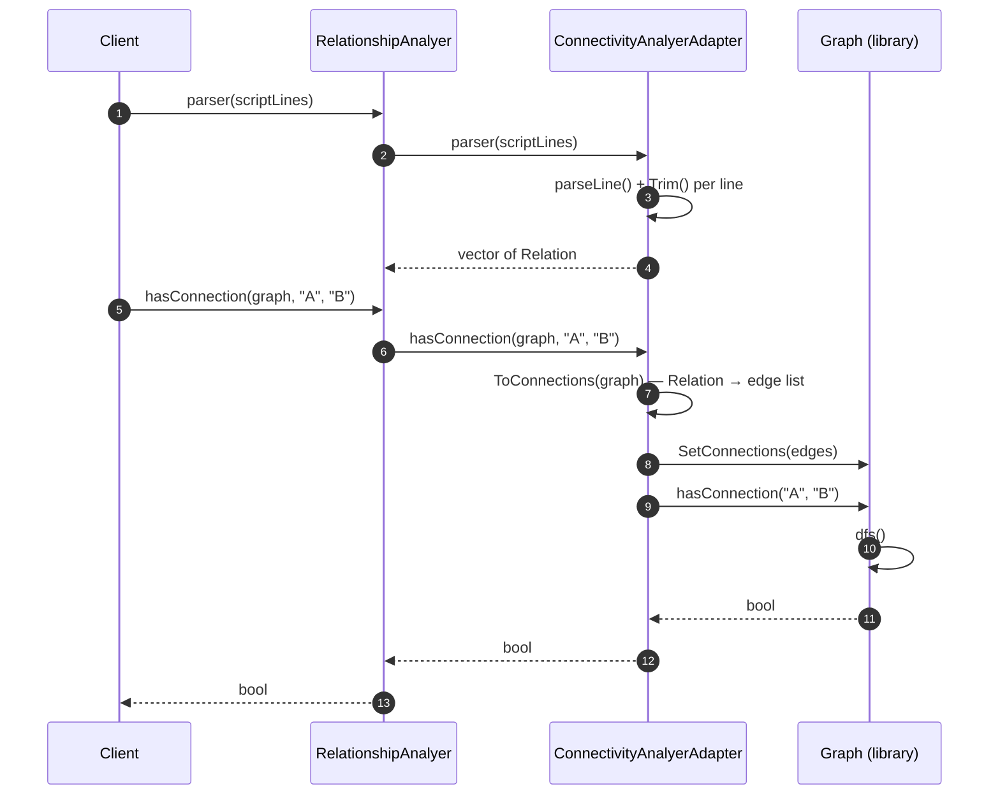

# friendship — Diagrams

> **Pattern:** Adapter (object adapter)

| Role | Class |
|---|---|
| Client | `RelationshipAnalyer` |
| Target | `RelationshipGraph` |
| Adapter | `ConnectivityAnalyerAdapter` |
| Adaptee | `Graph` (third-party style library) |

## Class Diagram

## Sequence Diagram — "are A and B connected?"

> The client never sees `Graph`'s data format. Swapping in another graph library means writing a new adapter only.
