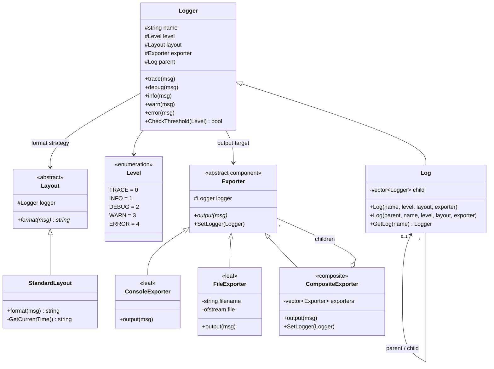
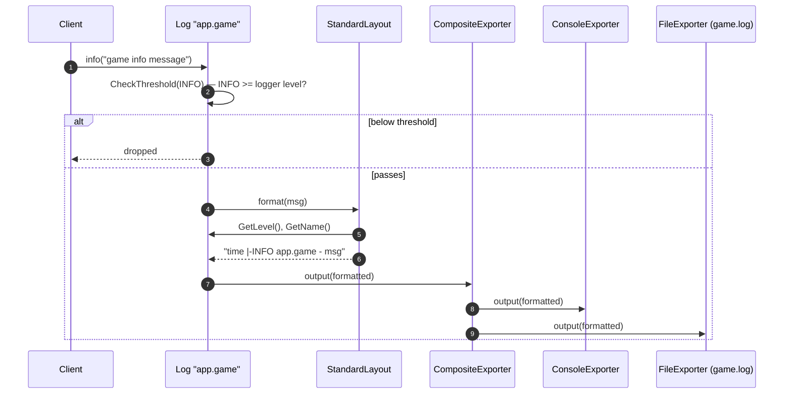

# logframework — Diagrams

> **Patterns:** Composite (`CompositeExporter`) + Strategy (`Layout`, `Exporter`) + logger hierarchy (parent / child tree)

## Class Diagram

## Sequence Diagram — `gamelog->info("...")`

Setup in `main()`:
`root (DEBUG, Console)` → `app.game (INFO, Composite[Console, File game.log])` → `app.game.ai (TRACE, Composite[Console, File ai.log])`

> `Logger` does not know it is writing to two places: `CompositeExporter` looks like any single `Exporter`.
