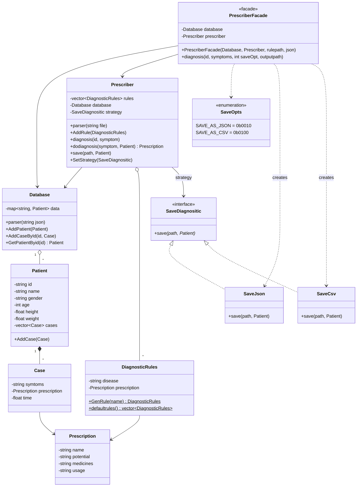
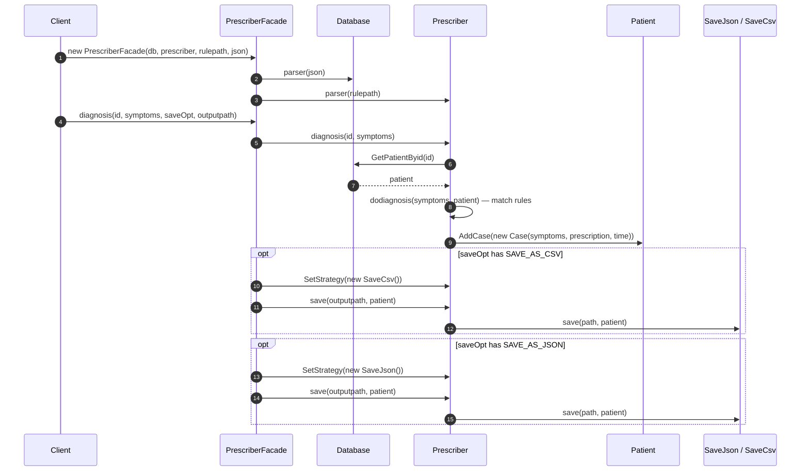

# prescriber_system — Diagrams

> **Patterns:** Facade (`PrescriberFacade`) + Strategy (`SaveDiagnositic`)

## Class Diagram

## Sequence Diagram — one diagnosis through the facade

> The client only talks to `PrescriberFacade`. Loading data, matching rules, recording the case and choosing an output format are hidden behind one call.

> ⚠️ **Code note:** `PrescriberFacade::diagnosis()` currently checks `saveOpt && SAVE_AS_CSV` (logical AND), which is true for any non-zero `saveOpt`, so both CSV and JSON are always saved. Bitwise `saveOpt & SAVE_AS_CSV` matches the diagram's intent.
