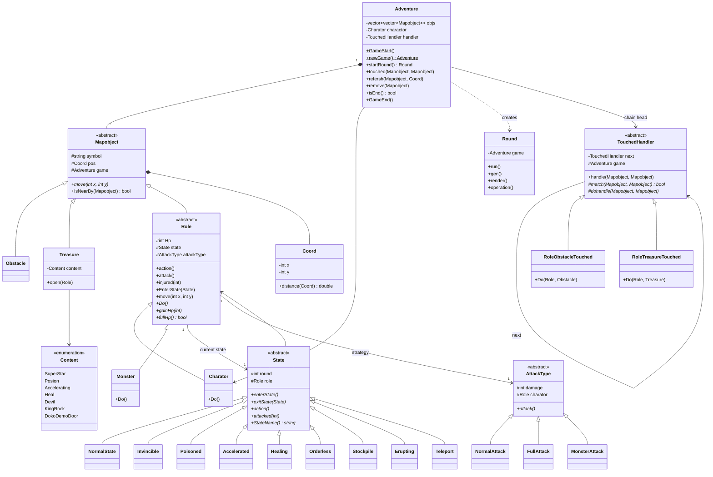
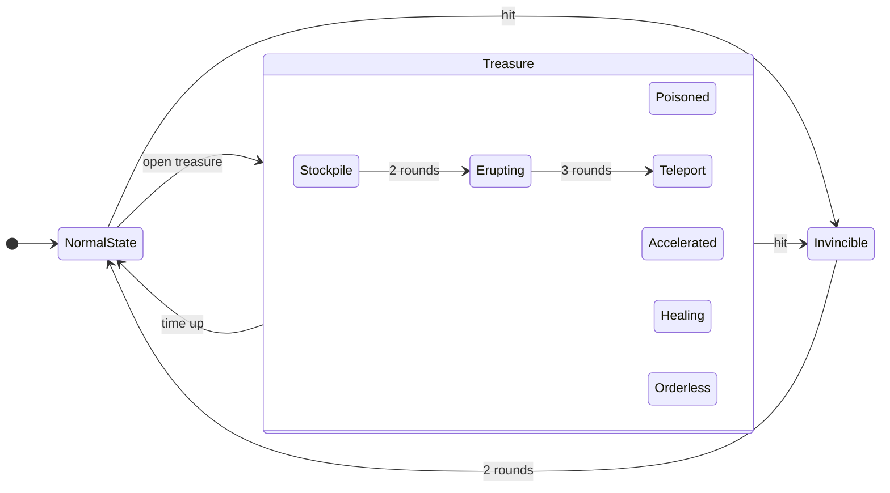
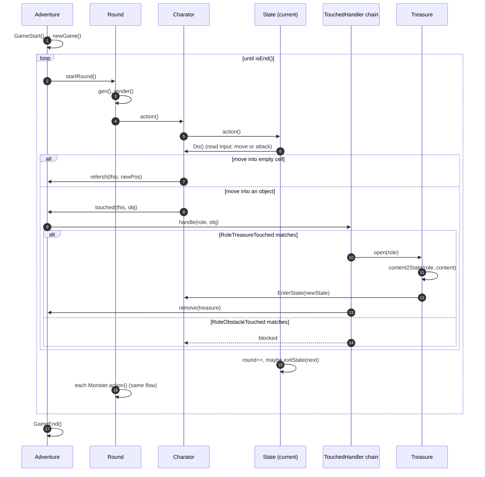
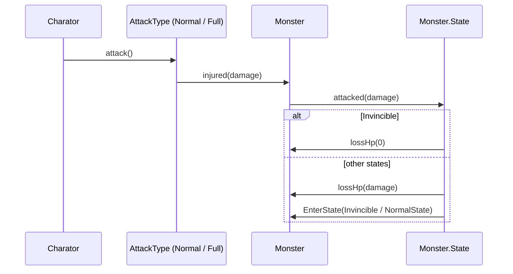

# treasuremap — Diagrams

> **Patterns:** State (`State`) + Strategy (`AttackType`) + Chain of Responsibility (`TouchedHandler`)

## Class Diagram

## State Diagram — role states

Opening a treasure calls `Role::EnterState()` from **any** state. Details per state:

| State | From treasure | Each round | Ends after | When attacked |
|---|---|---|---|---|
| NormalState | — | `Do()` once | — | lose HP → Invincible |
| Invincible | SuperStar | `Do()` once | 2 rounds → Normal | takes no damage |
| Poisoned | Posion | −15 HP, `Do()` | 3 rounds → Normal | lose HP → Invincible |
| Accelerated | Accelerating | `Do()` twice | 3 rounds → Normal | lose HP → Normal |
| Healing | Heal | +30 HP, `Do()` | 5 rounds or full HP → Normal | lose HP → Invincible |
| Orderless | Devil | random move | 3 rounds → Normal | lose HP → Invincible |
| Stockpile | KingRock | `Do()` | 2 rounds → Erupting | lose HP → Normal |
| Erupting | (from Stockpile) | `Do()` with `FullAttack` | 3 rounds → Teleport | lose HP → Invincible |
| Teleport | DokoDemoDoor | `Do()`, then jump to random cell | 1 round → Normal | lose HP → Invincible |

## Sequence Diagram — one round

## Sequence Diagram — attack uses the strategy, damage goes through the state

